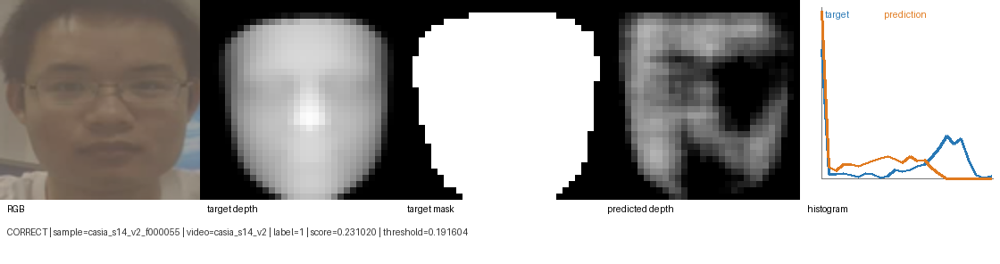
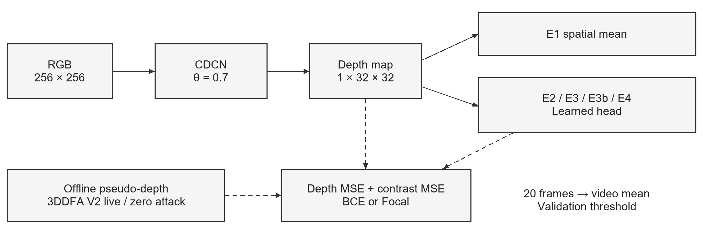
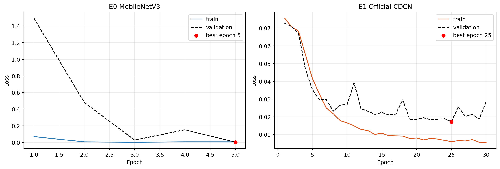
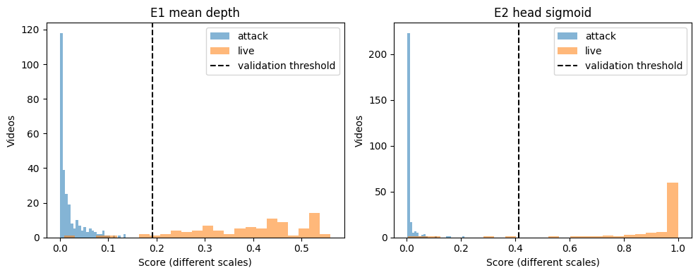
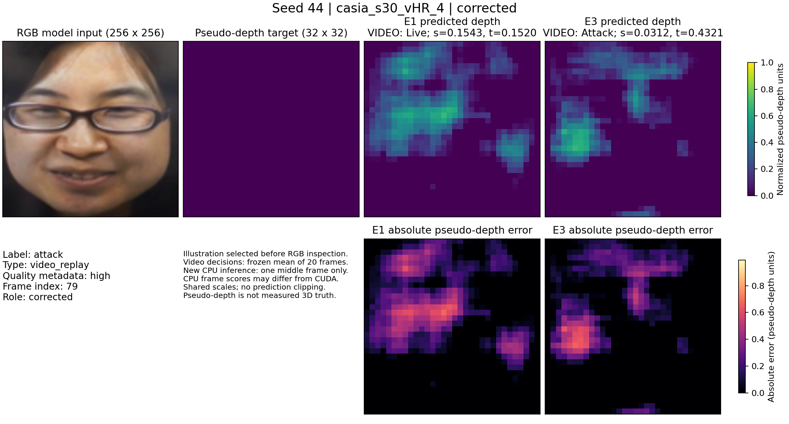
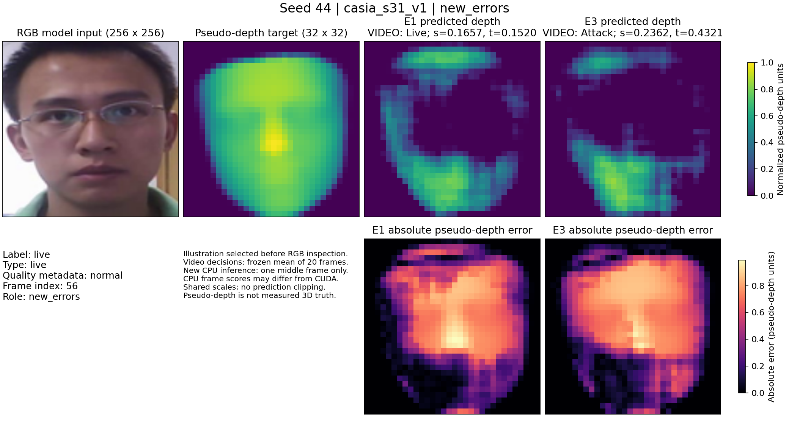

# BÁO CÁO CUỐI KỲ

Học phần THỊ GIÁC MÁY TÍNH

## Hệ thống nhận diện khuôn mặt thời gian thực tích hợp chống giả mạo dựa trên bản đồ độ sâu

Trường Đại học Bách khoa, Đại học Đà Nẵng

Khoa Công nghệ thông tin

Nhóm 1

| Sinh viên | Mã số sinh viên |
| --- | --- |
| Trịnh Minh Đạt | 102230180 |
| Nguyễn Hữu Minh Quân | 102230208 |

Giảng viên hướng dẫn TS. Huỳnh Hữu Hưng

Lớp học phần 1021673.2610.23.14

Phạm vi thực nghiệm: chống giả mạo khuôn mặt trên CASIA-FASD với các cấu hình E0–E4

Đà Nẵng, tháng 10 năm 2026

# Phân công trách nhiệm của hai thành viên

Trách nhiệm chuyên môn và công việc phối hợp của hai thành viên được phân chia như sau.

| Thành viên | Trách nhiệm chuyên môn | Trách nhiệm phối hợp |
| --- | --- | --- |
| Trịnh Minh Đạt (102230180) | Tổng quan tài liệu và xây dựng câu hỏi nghiên cứu; chuẩn bị và phân chia dữ liệu, tạo nhãn giả độ sâu; xây dựng tiêu chí đánh giá; thiết kế đối chứng E3 và phân tích kết quả, sai số. | Biên soạn cơ sở lý thuyết, phương pháp đánh giá và thảo luận; đối chiếu số liệu, kiểm tra cấu hình; cùng hoàn thiện báo cáo, bài báo và nội dung trình bày. |
| Nguyễn Hữu Minh Quân (102230208) | Thiết kế và triển khai các mô hình E0, E1, E2, E3b và E4; xây dựng quy trình huấn luyện, hàm mất mát và nhánh phân loại; đánh giá chi phí mô hình và thời gian suy luận. | Biên soạn kiến trúc, thiết lập thực nghiệm và kết quả; kiểm tra mã nguồn, khả năng tái lập; cùng hoàn thiện báo cáo, bài báo và nội dung trình bày. |

# Tóm tắt đề tài

Báo cáo đánh giá nhánh phân loại học sâu trên bản đồ giả độ sâu cho bài toán phát hiện tấn công trình diện khuôn mặt (Presentation Attack Detection, PAD). Nghiên cứu sử dụng CASIA-FASD gồm 600 video của 50 chủ thể, lấy 20 khung hình mỗi video và chia độc lập theo chủ thể thành 16 người huấn luyện, 4 người kiểm định và 30 người kiểm tra. Trọng số và ngưỡng được chọn từ tập kiểm định. Thực nghiệm seed 42 so sánh sáu cấu hình E0–E4; mạng tích chập sai phân trung tâm (CDCN) dùng trung bình không gian E1 và nhánh phân loại đóng băng mạng khung E2 cùng đạt tỷ lệ lỗi phân loại trung bình (Average Classification Error Rate, ACER) 2,7778%, trong khi E3/E3b đạt 5,0000% và E4 đạt 4,4444%. Với ba seed mới 43–45 trong cùng môi trường, E1 đạt ACER 4,3210 ± 2,1623% và E3 đạt 3,7037 ± 0,6415% (trung bình ± độ lệch chuẩn mẫu). Chênh lệch ghép cặp E3 − E1 là −0,6173 ± 2,6857 điểm phần trăm; E3 kém hơn tại seed 44. Nhánh phân loại bổ sung 1.265 tham số và tăng trung vị thời gian forward trên A100 khoảng 0,7961%. Phân tích hình lỗi và các lượt webcam đã đo cho thấy giới hạn của nhãn giả độ sâu, sai khác số học CPU/CUDA và lỗi từ chối người thật. Bằng chứng hiện có chưa xác nhận cải thiện ổn định hoặc khả năng triển khai xác thực khuôn mặt đáng tin cậy.

Từ khóa: Face anti-spoofing; Presentation attack detection; Central difference convolution; Pseudo-depth; Auxiliary supervision.

# Mục lục

[[TOC]]

## Danh mục hình

[[FIGURES]]

## Danh mục bảng

[[TABLES]]

# Chương 1 Tổng quan nghiên cứu liên quan

## 1.1 Bối cảnh và bài toán chống giả mạo

Một hệ thống xác thực sinh trắc học khuôn mặt hoàn chỉnh cần giải quyết đồng thời hai bài toán cốt lõi: xác định xem đối tượng xuất hiện trước camera là người thật (live/bona fide) hay không, và nếu là người thật thì danh tính của người đó là ai. Bài toán phát hiện tấn công trình diện (PAD) giải quyết câu hỏi thứ nhất, trong khi bài toán nhận diện khuôn mặt (Face Recognition) giải quyết câu hỏi thứ hai. Trong thực tế, một bức ảnh in trên giấy hoặc một đoạn video phát lại trên màn hình vẫn mang đầy đủ các đặc trưng hình thái của đúng chủ thể hợp lệ nhưng bản chất lại là một hành vi giả mạo. Do đó, kết quả nhận diện đúng danh tính không đồng nghĩa với việc mẫu thu nhận được là người thật.

Trọng tâm thực nghiệm của báo cáo này tập trung giải quyết bài toán PAD từ ảnh màu RGB (gồm ba kênh màu Đỏ, Lục và Lam). Mô hình nhận đầu vào là từng khung hình để dự đoán điểm số người thật (liveness score), sau đó tổng hợp điểm số trung bình trên toàn video để đưa ra quyết định phân loại cuối cùng. Trong khuôn khổ hiện tại, nhóm tập trung xây dựng và đánh giá chuyên sâu mô-đun chống giả mạo dựa trên bản đồ độ sâu; nhánh nhận diện danh tính chưa được tích hợp. Các lượt webcam thăm dò đã có được sử dụng để đánh giá giới hạn của nguyên mẫu PAD, chưa xác nhận khả năng xử lý thời gian thực đáng tin cậy.

## 1.2 Động cơ sử dụng bản đồ độ sâu

Bản đồ độ sâu (depth map) là một biểu diễn không gian hai chiều phản ánh cấu trúc hình học nổi tương đối của vùng khuôn mặt. Thay vì chỉ giám sát mô hình bằng một nhãn phân loại nhị phân (thật/giả) duy nhất cho toàn bộ bức ảnh, việc sử dụng bản đồ độ sâu cung cấp thêm tín hiệu giám sát cục bộ dày đặc tại từng điểm ảnh (pixel-wise supervision). Mạng tích chập sai phân trung tâm (Central Difference Convolutional Network – CDCN) kết hợp đồng thời thông tin cường độ sáng và độ chênh lệch đạo hàm cục bộ để ước lượng bản đồ độ sâu này [1]. Trong quy trình của nhóm, bản đồ độ sâu mục tiêu được ước lượng ngoại tuyến từ ảnh 2D phục vụ quá trình huấn luyện (gọi là bản đồ giả độ sâu – pseudo-depth), chứ không phải dữ liệu độ sâu vật lý thu từ cảm biến phần cứng chuyên dụng.

Mô hình đối chứng CDCN (cấu hình E1) tính giá trị trung bình cộng trên toàn bộ bản đồ độ sâu để làm điểm số phân loại người thật. Phương pháp lấy trung bình không gian này tuy đơn giản nhưng lại bỏ qua sự phân bố vị trí của các vùng hình thái quan trọng trên khuôn mặt. Về mặt trực giác, việc bổ sung một nhánh phân loại nhỏ gọn học trực tiếp từ bản đồ độ sâu có thể giúp khai thác cấu trúc không gian đó; tuy nhiên, nó cũng tiềm ẩn nguy cơ học vẹt (overfitting) vào các đặc trưng cục bộ kém bền vững, làm giảm khả năng tổng quát hóa khi gặp chủ thể mới. Chính vì vậy, hiệu quả thực sự của nhánh phân loại cần được kiểm chứng nghiêm ngặt bằng thực nghiệm có đối chứng thay vì mặc định rằng việc tăng thêm tham số sẽ mang lại kết quả tốt hơn.

## 1.3 Mục tiêu và phạm vi

Nghiên cứu đối sánh phương pháp tính điểm bằng trung bình không gian với nhánh phân loại học sâu trên bản đồ độ sâu, đồng thời đánh giá các chiến lược huấn luyện trên cùng kiến trúc CDCN. Đơn vị đánh giá chính là video; mục tiêu là giảm ACER tại ngưỡng quyết định được xác lập trên tập kiểm định. Kết quả được phân tích theo hiệu năng phân loại, thay đổi quyết định trên từng video, sai số bản đồ giả độ sâu và chi phí tính toán.

## 1.4 Nghiên cứu liên quan và lựa chọn đối chứng

Kiến trúc CDCN và biến thể mở rộng CDCN++ được nhóm tác giả Yu và cộng sự giới thiệu vào năm 2020 [1]. Nhóm nghiên cứu lựa chọn cấu trúc (topology) CDCN tiêu chuẩn làm mô hình đối chứng vì mã nguồn tham chiếu công khai cho phép kiểm chứng chính xác từng lớp mạng và phép toán thành phần. Bên cạnh đó, mô hình 3DDFA V2 [2] được sử dụng để ước lượng hình học khuôn mặt 3D từ ảnh 2D, đóng vai trò công cụ sinh nhãn giả độ sâu ngoại tuyến. Trong các nghiên cứu gần đây, kiến trúc UCDCN [3] cũng đã kết hợp mạng dự đoán độ sâu với một bộ phân loại đầu ra; do đó, báo cáo này tập trung vào việc phân tích thực nghiệm có kiểm soát các phương án huấn luyện bộ phân loại trên cùng kiến trúc CDCN chứ không tuyên bố ý tưởng kết hợp bộ phân loại độ sâu là hoàn toàn mới.

Bảng 1 Các nguồn nghiên cứu và vai trò trong thực nghiệm

| Công trình | Nội dung kế thừa hoặc khảo sát | Vai trò và giới hạn |
| --- | --- | --- |
| CDCN, 2020 [1] | Phép tích chập sai phân trung tâm (CDC), cấu trúc mạng và hàm mất mát độ sâu | Mô hình đối chứng E1; đánh giá trên giao thức phát triển của nhóm |
| 3DDFA V2, 2020 [2] | Ước lượng hình học khuôn mặt 3D dày đặc từ ảnh RGB 2D | Công cụ sinh nhãn giả độ sâu ngoại tuyến; không sử dụng khi suy luận PAD |
| UCDCN, 2024 [3] | Kiến trúc mạng dự đoán độ sâu kết hợp bộ phân loại đầu ra | Công trình tiền lệ có liên quan về mặt ý tưởng kết hợp bộ phân loại độ sâu |
| MobileNetV3, 2019 [4] | Kiến trúc mạng tích chập phân loại ảnh gọn nhẹ | Mô hình đối chứng RGB tham khảo (E0); khác kích thước đầu vào và hàm mất mát với E1 |
| Focal loss, 2017 [5] | Hàm mất mát giảm trọng số các mẫu dễ đã phân loại với độ tự tin cao | Hàm mất mát phân loại thử nghiệm ở cấu hình E4 để đối sánh với BCE |

Các công trình liên quan cung cấp cơ sở cho kiến trúc mạng, giám sát độ sâu và hàm mất mát của nghiên cứu. Do khác nhau về phân chia dữ liệu, tiền xử lý và quy tắc chọn ngưỡng, các chỉ số công bố trong những công trình đó không trực tiếp xác định thứ hạng của các cấu hình đang xét. Phép đối sánh trong báo cáo tập trung vào cơ chế trích xuất điểm phân loại và chiến lược huấn luyện dưới cùng giao thức phát triển CASIA-FASD.

## 1.5 Ưu điểm và hạn chế của các hướng nghiên cứu

### 1.5.1 Phân loại trực tiếp từ ảnh RGB

MobileNetV3 [4] là kiến trúc phân loại ảnh được thiết kế theo hướng cân bằng độ chính xác và chi phí tính toán. Trong bài toán PAD, một mạng phân loại RGB có ưu điểm là chỉ cần nhãn thật/giả và có thể tận dụng trọng số tiền huấn luyện. Hạn chế của thiết lập này là nhãn toàn ảnh không quy định rõ vùng không gian nào phải mang tín hiệu phân biệt. Với dữ liệu quy mô nhỏ, kết quả trên một phân chia chưa đủ cho biết đặc trưng học được có bền vững khi đổi thiết bị hoặc môi trường hay không. Trong nghiên cứu này, MobileNetV3-Small chỉ là đối chứng RGB; hiệu năng E0 không đại diện cho mọi phương pháp phân loại RGB.

CASO-PAD [6] mở rộng MobileNetV3 bằng toán tử không gian thích ứng theo nội dung (involution). Thay vì dùng cùng bộ lọc tại mọi vị trí, toán tử này sinh trọng số phụ thuộc đầu vào tại từng vị trí và chia sẻ trong nhóm kênh. Ưu điểm là cơ chế lựa chọn thông tin không gian được học trực tiếp từ ảnh với chi phí tương đối nhỏ theo thiết lập tác giả công bố. Công trình báo cáo cả phép thử trong tập dữ liệu và chéo tập dữ liệu. Tuy nhiên, kết quả vẫn phụ thuộc giao thức; ACER trên OULU-NPU complete, P1 và P2 lần lượt là 0,42%, 4,38% và 1,81% (Bảng 5 và 8 của công trình). Sự khác biệt này cho thấy một giá trị tổng hợp thuận lợi chưa thay thế được kiểm tra ở điều kiện khó hơn. Bài báo được sử dụng ở phiên bản Article in Press có DOI, chưa phải nguồn khẳng định hiệu quả của phương pháp nhóm.

### 1.5.2 Giám sát bằng bản đồ giả độ sâu và CDCN

CDCN [1] bổ sung thành phần sai phân trung tâm vào tích chập để khai thác đồng thời cường độ và biến thiên cục bộ. Giám sát bằng bản đồ độ sâu tạo tín hiệu tại nhiều vị trí thay vì một nhãn toàn ảnh. Ưu điểm đối với nghiên cứu có đối chứng là kiến trúc, phép toán và hàm mất mát có mã nguồn tham chiếu [7]. Nhờ đó, việc thay cơ chế tính điểm cuối có thể được phân tích trên cùng một mạng khung.

Hạn chế nằm ở chất lượng nhãn hình học và khả năng chuyển miền. Nhãn giả độ sâu được suy từ ảnh RGB; bản đồ bằng không cho tấn công là quy ước huấn luyện, trong khi ảnh in uốn cong hoặc màn hình vẫn có hình học vật lý. Trong bài CDCN, ACER 1,0% trên OULU-NPU P1 và HTER 32,6% ở phép thử Replay-Attack sang CASIA thuộc hai giao thức khác nhau (Bảng 4 và 7). Các kết quả này tạo động cơ đánh giá riêng khả năng tổng quát hóa. CDCN++ có ACER 0,2% ở P1 nhưng là kiến trúc tìm kiếm mở rộng, không tương đương CDCN tiêu chuẩn được dùng ở E1.

### 1.5.3 Hợp nhất đặc trưng và bộ phân loại độ sâu trong UCDCN

UCDCN [3] kết hợp phép CDC với cấu trúc lồng UNet++ để hợp nhất thông tin ngữ nghĩa ở nhiều mức. Công trình còn khảo sát nhánh phân loại ở đầu ra và rút gọn mạng thành biến thể L2. Ưu điểm là cải thiện khả năng khai thác cấu trúc không gian và khảo sát chi phí triển khai cùng hiệu năng. Sự tồn tại của nhánh phân loại độ sâu trong UCDCN xác lập tiền lệ cho hướng nghiên cứu; đóng góp của đề tài hiện tại là kiểm tra thực nghiệm các cấu hình trên cùng CDCN, không phải phát minh ý tưởng nhánh phân loại.

Đổi lại, cấu trúc lồng, cách hợp nhất và chiến lược huấn luyện của UCDCN tạo thành một thiết kế khác E3. Kết quả ACER 0,9% của L2 trên OULU-NPU P1/P2 không cô lập tác dụng của nhánh phân loại khi gắn vào CDCN của nhóm. Quy tắc ngưỡng 0,5 được nêu cho thí nghiệm bộ phân loại tại Bảng 7 của UCDCN; nguồn đã đọc chưa xác định cùng quy tắc đó cho Bảng 5. Tốc độ công bố trên RTX 3090 cũng khác phép đo A100 của đề tài. Vì vậy, UCDCN phù hợp làm công trình gần về phương pháp hơn là một đối chứng số liệu trực tiếp.

### 1.5.4 Công cụ sinh nhãn và hàm mất mát

3DDFA V2 [2] ước lượng hình học khuôn mặt dày đặc từ ảnh 2D và được sử dụng ngoại tuyến để tạo mục tiêu độ sâu. Ưu điểm là bổ sung tín hiệu hình học khi không có cảm biến độ sâu. Hạn chế là sai lệch ước lượng có thể truyền vào nhãn; giá trị mục tiêu chuẩn hóa không phải độ sâu tính bằng centimet. Việc tái tạo tốt mục tiêu vì vậy chưa bảo đảm phân loại PAD tốt hoặc đo hình học đúng.

Focal loss [5] được đề xuất cho phát hiện vật thể để giảm đóng góp của các ví dụ dễ. Khi áp dụng cho PAD, ưu điểm tiềm năng là thay đổi trọng số tương đối của các khung hình khó mà không đổi kiến trúc suy luận. Hạn chế là lợi ích phụ thuộc hệ số cân bằng lớp, độ khó dữ liệu và quy tắc chọn mô hình. Bằng chứng từ bài toán phát hiện vật thể không tự xác nhận hiệu quả trên PAD; cặp E3b–E4 trong đề tài kiểm tra trực tiếp việc thay BCE bằng Focal trên cùng lịch trình ở seed 42.

## 1.6 Khoảng trống thực nghiệm và câu hỏi nghiên cứu

Các công trình trên cho thấy biểu diễn không gian và cách tổng hợp điểm số đều có thể ảnh hưởng PAD, nhưng hiệu quả của một nhánh phân loại nhỏ trên mạng CDCN cụ thể cần được đo trong cùng điều kiện dữ liệu. Câu hỏi thứ nhất là liệu thay phép trung bình không gian bằng nhánh phân loại có giảm ACER khi giữ nguyên mạng khung hay không. Cặp E1–E2 ở seed 42 kiểm tra câu hỏi này bằng cách cố định cả trọng số và thống kê BatchNorm của mạng khung.

Câu hỏi thứ hai là chiến lược huấn luyện và hàm mất mát ảnh hưởng như thế nào đến quyết định trên từng video. E3–E3b so sánh huấn luyện đồng thời với huấn luyện theo giai đoạn bằng BCE; E3b–E4 so sánh BCE với Focal trên cùng lịch trình. Sau khi chọn E3 bằng validation, ba seed 43–45 đánh giá sự biến thiên của cặp cấu hình E1/E3. Vì E3 có thêm 16 epoch và hệ số suy giảm trọng số khác E1, phép thử nhiều seed đánh giá hai cấu hình hoàn chỉnh, chưa tách riêng tác dụng nhân quả của nhánh phân loại.

Câu hỏi thứ ba là chi phí và hành vi ngoài tập dữ liệu của cấu hình được chọn. Phép đo A100 xem xét thời gian forward và số tham số; các lượt webcam thăm dò xem xét tốc độ xử lý thực, thời gian gom cửa sổ và lỗi quyết định. Hai phép đo khác phần cứng, miền dữ liệu và phạm vi tính thời gian nên được trình bày riêng.

## 1.7 Phạm vi đóng góp

Nghiên cứu cung cấp đối sánh kiến trúc đầu ra và chiến lược huấn luyện trên một phân chia CASIA-FASD cố định, kết hợp chỉ số cấp video, biến thiên qua ba seed, lỗi trên từng video tương ứng và chi phí forward. Phân tích trực quan bổ sung trường hợp sửa được lỗi lẫn trường hợp phát sinh lỗi mới. Các quan sát webcam làm rõ khoảng cách giữa kết quả development và hoạt động trên camera laptop. Phạm vi này là nghiên cứu thực nghiệm có kết quả bất lợi, chưa thiết lập ưu thế tổng quát so với các công trình dùng giao thức khác.

# Chương 2 Giải pháp và thiết kế thực nghiệm

## 2.1 Bộ dữ liệu và các loại mẫu

Tập dữ liệu CASIA Face Anti-Spoofing Database (CASIA-FASD) là bộ dữ liệu chuẩn phổ biến chứa các video khuôn mặt người thật cùng nhiều phương thức tấn công trình diện đa dạng [8]. Nhóm nghiên cứu sử dụng phiên bản trích xuất khung hình từ nguồn Kaggle (immada/casia-fasd), bao gồm 50 chủ thể với tổng cộng 600 video. Các mẫu trong tập dữ liệu bao gồm khuôn mặt người thật (live) và ba loại hình tấn công: ảnh in trên giấy bị uốn cong (warped photo), ảnh in bị cắt thủng vùng mắt (cut photo) và video phát lại trên màn hình (video replay). Thuộc tính chất lượng hình ảnh (quality) trong danh mục dữ liệu được phân thành ba mức: cao (high), bình thường (normal) và thấp (low) dựa theo siêu dữ liệu định danh của bộ dữ liệu gốc.

Trong bước làm sạch và chuẩn hóa cấu trúc dữ liệu, bộ phân tích (parser) của nhóm đã hiệu chỉnh lại ánh xạ của chuỗi video HR_1 về đúng nhãn người thật theo đặc tả của CASIA-FASD gốc (do bản sao thứ cấp xếp nhầm chuỗi này vào thư mục giả mạo). Đồng thời, các tệp ảnh dẫn xuất mang tiền tố bs hoặc fs cũng được loại bỏ hoàn toàn nhằm tránh việc trộn lẫn các phiên bản ảnh đã qua xử lý hậu kỳ với ảnh nguồn. Từ mỗi video, hệ thống trích xuất cách đều 20 khung hình theo thứ tự thời gian, tạo ra tổng cộng 12.000 khung hình cho toàn bộ 600 video.

## 2.2 Phân chia dữ liệu theo chủ thể

Tập dữ liệu được chia thành ba phân tập độc lập: tập huấn luyện (train) dùng để tối ưu hóa trọng số mô hình, tập kiểm định (validation) dùng để lựa chọn trọng số tốt nhất (checkpoint) cùng ngưỡng quyết định, và tập kiểm tra (test) dùng để đánh giá hiệu năng cuối cùng của các cấu hình đã cố định. Bốn chủ thể mang mã định danh 4, 9, 14 và 19 từ tập huấn luyện gốc được tách riêng để lập thành tập kiểm định. Việc phân chia đảm bảo tính tách biệt hoàn toàn về mặt chủ thể và video giữa ba phân tập (subject-disjoint split), giúp ngăn ngừa hiện tượng rò rỉ dữ liệu (data leakage) do sự tương đồng giữa các khung hình của cùng một người.

Bảng 2 Dữ liệu theo phân tập và đơn vị đánh giá

| Tập | Người | Video giả | Video thật | Tổng video | Frame |
| --- | --- | --- | --- | --- | --- |
| Train | 16 | 144 | 48 | 192 | 3840 |
| Validation | 4 | 36 | 12 | 48 | 960 |
| Test phát triển | 30 | 270 | 90 | 360 | 7200 |
| Tổng | 50 | 450 | 150 | 600 | 12000 |

Phân chia nêu trên là giao thức phát triển (development protocol) được nhóm thiết lập phục vụ chuỗi thực nghiệm đối sánh, khác với giao thức đánh giá chuẩn trong bài báo CDCN gốc [1]. Do tập kiểm tra phát triển đã được sử dụng xuyên suốt các vòng thực nghiệm của đề tài, các chỉ số đạt được đóng vai trò minh chứng so sánh giữa các cấu hình trong quá trình phát triển mô hình, trước khi tiến hành kiểm thử trên các bộ dữ liệu độc lập hoàn toàn mới.

## 2.3 Lấy mẫu khung hình và tiền xử lý

Các khung hình của phiên bản dữ liệu đã tập trung vào vùng khuôn mặt; tiền xử lý giữ cùng vùng ảnh và thay đổi kích thước đầu vào theo từng nhóm mô hình. E0 sử dụng ảnh RGB 224 × 224 với chuẩn hóa ImageNet. Các cấu hình E1–E4 sử dụng ảnh RGB 256 × 256, chuẩn hóa từng kênh bằng trung bình 0,5 và độ lệch chuẩn 128/255. Phép lật ngang trong huấn luyện được áp dụng đồng bộ cho ảnh và bản đồ mục tiêu.

Trong pha huấn luyện, kỹ thuật tăng cường dữ liệu lật ngang ngẫu nhiên (random horizontal flip) với xác suất 0,5 được áp dụng đồng bộ cho cả ảnh đầu vào RGB và bản đồ độ sâu mục tiêu. Trong pha kiểm định và kiểm tra, dữ liệu được giữ nguyên hoàn toàn mà không áp dụng phép biến đổi ngẫu nhiên nào. Bản đồ độ sâu mục tiêu được đưa về kích thước 32 × 32; trong trường hợp giá trị cực đại trên bản đồ vượt quá 1, toàn bộ bản đồ được chuẩn hóa bằng cách chia cho giá trị cực đại đó. Các cấu hình dựa trên độ sâu tuân thủ quy trình tiền xử lý này.

## 2.4 Xây dựng nhãn giả độ sâu

Mô hình 3DDFA V2 sinh bản đồ giả độ sâu cho 3.000 khung hình người thật. Với 9.000 khung hình tấn công, bản đồ mục tiêu được gán bằng 0 theo quy ước giám sát. Cách gán nhãn này tạo mục tiêu học khác nhau giữa hai lớp, không mô tả độ sâu vật lý thực tế của mọi phương tiện tấn công. Mô hình 3DDFA V2 và bản đồ mục tiêu phục vụ chuẩn bị nhãn và đánh giá sai số độ sâu; suy luận PAD chỉ sử dụng ảnh RGB.

Hình 1 minh họa kết quả trực quan hóa từ mô hình đối chứng CDCN E1 trên mẫu người thật casia_s14_v2_f000055 thuộc tập kiểm định. Từ trái sang phải lần lượt là: ảnh màu RGB đầu vào, nhãn giả độ sâu mục tiêu, vùng mặt nạ khuôn mặt (face mask), bản đồ độ sâu do mô hình dự đoán và biểu đồ tần suất (histogram) phân bố giá trị điểm ảnh. Có thể quan sát thấy rằng mặc dù bản đồ độ sâu dự đoán có một số vùng cục bộ chưa trùng khớp hoàn toàn với nhãn mục tiêu, giá trị trung bình tổng thể vẫn đủ cao để mô hình đưa ra quyết định phân loại đúng.

## 2.5 Đặc tính và giới hạn của nhãn giả độ sâu

Tập nhãn gồm 12.000 bản đồ giả độ sâu: 3.000 bản đồ cho khung hình người thật và 9.000 bản đồ cho khung hình tấn công. Các bản đồ có giá trị hữu hạn; nhãn của khung hình người thật chứa giá trị khác không, còn nhãn tấn công bằng không theo quy ước giám sát.

Bảng 3 Đặc tính nhãn giả độ sâu và phân chia dữ liệu

| Hạng mục | Số lượng | Đặc tính nhãn | Ý nghĩa khi huấn luyện |
| --- | --- | --- | --- |
| Người thật | 3000 | 100% bản đồ hữu hạn và khác không | Giám sát hình học khuôn mặt ước lượng |
| Tấn công | 9000 | 100% bản đồ bằng không | Mục tiêu giám sát theo quy ước thật/giả |
| Toàn bộ dữ liệu | 12000 | Đủ nhãn giả độ sâu | Sử dụng cho huấn luyện và đánh giá sai số |
| Phân chia dữ liệu | 50 chủ thể, 600 video | Chủ thể và video độc lập giữa các phân tập | Hạn chế rò rỉ do trùng chủ thể hoặc video |

Tính hữu hạn và cấu trúc khác không chỉ xác nhận điều kiện sử dụng nhãn trong huấn luyện, chưa xác nhận độ chính xác hình học 3D của bản đồ giả độ sâu. Góc mặt nghiêng, che khuất hoặc sai lệch ước lượng khuôn mặt có thể ảnh hưởng đến hình dạng mục tiêu. Sai số độ sâu vì vậy được trình bày trên miền giá trị chuẩn hóa, không quy đổi sang centimet.

## 2.6 Quy ước nhãn và tính nhất quán giữa các cấu hình

Nhãn phân loại được quy ước bằng 1 cho khung hình người thật và bằng 0 cho khung hình tấn công. Mọi khung hình trong cùng video có cùng nhãn và thuộc cùng phân tập. Các cấu hình E0–E4 sử dụng cùng danh sách video và cùng phân chia chủ thể, nhằm duy trì điều kiện dữ liệu thống nhất khi đối sánh hiệu năng.

## 2.7 Quy trình xử lý và các phương án

Quy trình xử lý tổng thể tiếp nhận đầu vào là các khung hình RGB, dự đoán điểm số phân loại cho từng khung hình riêng lẻ, sau đó lấy giá trị trung bình cộng của 20 khung hình để tạo thành điểm số quyết định ở cấp độ video. Trong hệ thống thực nghiệm của nhóm, cấu hình E0 là mô hình MobileNetV3-Small thực hiện phân loại nhị phân trực tiếp từ ảnh RGB. Cấu hình E1 là mô hình CDCN tiêu chuẩn sử dụng phép lấy trung bình không gian trên bản đồ độ sâu. Cấu hình E2 giữ nguyên mạng khung tạo bản đồ độ sâu của E1 nhưng thay thế phép tính trung bình bằng một nhánh phân loại tích chập nhỏ gọn. Các cấu hình E3, E3b và E4 sử dụng chung kiến trúc mạng có nhánh phân loại của E2 nhưng áp dụng các chiến lược huấn luyện và hàm mất mát khác nhau nhằm đánh giá tác động của việc tinh chỉnh đồng thời hoặc chia giai đoạn.

Hình 2 trình bày luồng suy luận và giám sát huấn luyện. Mạng khung (backbone) chuyển ảnh RGB thành bản đồ độ sâu kích thước 1 × 32 × 32; cơ chế trích xuất điểm phân loại chuyển bản đồ này thành điểm số người thật. E1 dùng trung bình không gian, còn E2–E4 sử dụng nhánh phân loại đầu ra (classification head) có tham số. Các mũi tên nét liền biểu thị suy luận; mũi tên nét đứt biểu thị tín hiệu giám sát từ nhãn giả độ sâu và nhãn thật/giả.

## 2.8 Đối chứng RGB E0

Cấu hình đối chứng E0 sử dụng kiến trúc mạng gọn nhẹ MobileNetV3-Small [4], được khởi tạo từ bộ trọng số tiền huấn luyện (pre-trained weights) và thay thế tầng phân loại cuối bằng một nút đầu ra nhị phân duy nhất. Giá trị đầu ra thô (logit) được đưa qua hàm kích hoạt Sigmoid để ánh xạ về miền xác suất trong khoảng (0, 1). Mô hình E0 được huấn luyện trực tiếp bằng hàm mất mát entropy chéo nhị phân (Binary Cross-Entropy – BCE) trên nhãn thật/giả.

Cấu hình E0 đóng vai trò làm mốc tham chiếu cho hướng tiếp cận phân loại ảnh RGB thuần túy. Do E0 và E1 khác biệt toàn diện về kiến trúc mạng khung, độ phân giải đầu vào, phương pháp chuẩn hóa và hàm mất mát mục tiêu, phép so sánh giữa E0 và E1 chỉ mang ý nghĩa đối chiếu tổng thể giữa hai hướng tiếp cận chứ không nhằm cô lập riêng rẽ tác động nhân quả của cơ chế giám sát độ sâu. Để đánh giá chính xác vai trò của cơ chế trích xuất điểm phân loại từ bản đồ độ sâu, phép đối sánh có kiểm soát chặt chẽ nhất trong nghiên cứu này là giữa E1 và E2 trên cùng một mạng khung đã cố định.

## 2.9 CDCN tính điểm bằng trung bình không gian E1

Phép tích chập hai chiều truyền thống (vanilla convolution) tính tổng có trọng số của các điểm ảnh trong vùng lân cận cục bộ để trích xuất đặc trưng cường độ sáng. Phép tích chập sai phân trung tâm (Central Difference Convolution – CDC) mở rộng cơ chế này bằng cách bổ sung thêm thành phần chênh lệch (gradient) giữa các điểm ảnh lân cận so với điểm ảnh trung tâm. Xét tại tọa độ tâm p₀ cùng các vector độ lệch p trong cửa sổ lân cận R, phép toán CDC được xác định bởi công thức:

::equation:: y(p₀) = Σₚ w(p)x(p₀+p) − θx(p₀)Σₚ w(p)

Hệ số điều chỉnh thành phần sai phân θ được đặt bằng 0,7 theo thiết lập của CDCN [1]. Khi θ = 0, biểu thức trở về phép tích chập thông thường. Với θ > 0, thành phần dựa trên giá trị tại tâm bổ sung thông tin chênh lệch cục bộ vào biểu diễn đặc trưng.

Bảng 4 Kích thước chính của CDCN trên một ảnh RGB 256

| Vị trí | Số kênh × chiều cao × chiều rộng | Cách sử dụng |
| --- | --- | --- |
| Đầu vào | 3 × 256 × 256 | RGB đã chuẩn hóa |
| Sau block 1 | 128 × 128 × 128 | Resize về 32 × 32 |
| Sau block 2 | 128 × 64 × 64 | Resize về 32 × 32 |
| Sau block 3 | 128 × 32 × 32 | Giữ kích thước depth |
| Hợp nhất | 384 × 32 × 32 | Nối ba mức theo kênh |
| Đầu ra | 1 × 32 × 32 | Mean toàn map cho E1 |

Cấu trúc mạng CDCN trích xuất đặc trưng qua ba khối đa mức (low-level, mid-level và high-level). Các bản đồ đặc trưng từ ba khối này được nội suy song tuyến (bilinear interpolation) về cùng kích thước không gian 32 × 32, sau đó ghép nối theo chiều kênh (concatenation) để tạo thành tensor hợp nhất 384 × 32 × 32, trước khi đi qua chuỗi lớp tích chập giảm chiều kênh 384 → 128 → 64 → 1 để sinh ra bản đồ độ sâu cuối cùng. Lớp kích hoạt ReLU ở đầu ra đảm bảo các giá trị độ sâu dự đoán luôn không âm. Ở cấu hình E1, điểm số phân loại được tính bằng trung bình cộng trên toàn bộ 32 × 32 điểm ảnh của bản đồ dự đoán mà không sử dụng mặt nạ khuôn mặt (face mask).

## 2.10 Phạm vi kế thừa kiến trúc CDCN

Mô hình đối chứng kế thừa kiến trúc CDCN tiêu chuẩn từ công trình gốc [1] và mã nguồn tác giả [7]. Nghiên cứu sử dụng quy trình phân chia dữ liệu, sinh nhãn giả độ sâu, huấn luyện và đánh giá riêng cho CASIA-FASD. Vì vậy, các kết quả phản ánh phép đối sánh trong thiết lập hiện tại, thay vì tái lập toàn bộ giao thức đánh giá của công trình gốc.

## 2.11 Nhánh phân loại học sâu trên bản đồ độ sâu E2

Cấu hình E2 sử dụng trọng số mạng khung được chọn từ E1, cố định toàn bộ tham số cùng thống kê chuẩn hóa theo lô (Batch Normalization) trong quá trình huấn luyện. Nhánh phân loại tiếp nhận bản đồ độ sâu 1 × 32 × 32, lần lượt đi qua Conv(1 → 8) và Conv(8 → 16), đều có bộ lọc 3 × 3, đệm biên bằng 1 và hàm ReLU. Tầng gộp trung bình toàn cục (Global Average Pooling – GAP) tạo vector đặc trưng cho lớp tuyến tính Linear(16 → 1); hàm Sigmoid chuyển đầu ra thành điểm số phân loại.

Nhánh phân loại bổ sung 1.265 tham số: 80 ở lớp tích chập thứ nhất, 1.168 ở lớp tích chập thứ hai và 17 ở lớp tuyến tính cuối. Tổng số tham số tăng từ 2.245.016 lên 2.246.281. Do 100% tham số và thống kê mạng khung được giữ cố định, E1 và E2 sử dụng cùng bản đồ độ sâu; khác biệt nằm ở phép ánh xạ bản đồ sang điểm số phân loại.

## 2.12 Hàm mất mát và tham số được cập nhật

Quá trình huấn luyện mạng dựa trên việc tối thiểu hóa hàm mất mát (loss function) phản ánh độ sai lệch giữa dự đoán của mô hình và nhãn mục tiêu. Hàm mất mát độ sâu (depth loss) trong kiến trúc CDCN chính thức là sự kết hợp giữa sai số bình phương trung bình (Mean Squared Error – MSE) trên toàn bản đồ độ sâu và sai số MSE tương phản trên tám hướng sai phân lân cận:

::equation:: L_depth = MSE(D_pred, D_target) + MSE(ΔD_pred, ΔD_target)

Trong công thức trên, toán tử Δ đại diện cho bộ tám bộ lọc cố định tính hiệu số độ sâu giữa mỗi điểm ảnh lân cận trong vùng 3 × 3 so với điểm ảnh tâm (được thực hiện bằng phép tích chập không đệm biên). Hai thành phần mất mát này được kết hợp với trọng số ngang nhau và đều bằng 1. Mô hình đối chứng E1 chỉ sử dụng duy nhất hàm mất mát L_depth trong suốt quá trình huấn luyện.

Đối với bài toán phân loại nhị phân, với nhãn thực tế y ∈ {0, 1} và xác suất dự đoán p ∈ (0, 1), hàm mất mát entropy chéo nhị phân (BCE) trên từng khung hình được xác định bởi:

::equation:: L_BCE = −[y ln(p) + (1−y) ln(1−p)]

Ở cấu hình E2, chỉ có các tham số của nhánh phân loại được cập nhật thông qua hàm mất mát L_BCE (hệ số của L_depth bằng 0). Ở các cấu hình E3 và giai đoạn kết hợp (joint stage) của E3b, cả mạng khung và nhánh phân loại được tối ưu hóa đồng thời bằng tổng hàm mất mát L_total = L_depth + L_BCE (hệ số trọng số phân loại bằng 1). Đối với cấu hình E4, thành phần phân loại BCE được thay thế bằng hàm mất mát Focal [5]:

::equation:: L_Focal = −α_t(1−p_t)^γ ln(p_t), với γ = 2

Trong công thức Focal, p_t là xác suất dự đoán cho lớp nhãn đúng và γ = 2 là hệ số điều biến. Hệ số cân bằng lớp α_t bằng 0,25 đối với người thật và 0,75 đối với tấn công. Thừa số (1 − p_t)^γ giảm đóng góp của các khung hình được phân loại đúng với độ tự tin cao, qua đó tăng vai trò tương đối của những khung hình khó. Phép đối sánh E3b–E4 đánh giá thay đổi này trên cùng lịch trình huấn luyện theo giai đoạn.

## 2.13 Cấu hình và lịch trình huấn luyện

Trong thiết lập huấn luyện, mỗi chu kỳ (epoch) tương ứng với một lượt duyệt qua toàn bộ tập huấn luyện; kích thước lô (batch size) quy định số lượng mẫu xử lý trong mỗi bước cập nhật trọng số. Các nhánh mô hình dựa trên độ sâu được tối ưu hóa bằng thuật toán Adam với tốc độ học (learning rate – LR) và hệ số suy giảm trọng số (weight decay – WD) được chuẩn hóa rõ ràng trong tệp cấu hình. Để đảm bảo tính nhất quán và khả năng tái lập kết quả, đợt khảo sát sáu cấu hình sử dụng hạt giống (seed) 42; đợt lặp E1/E3 sử dụng ba seed 43, 44 và 45.

Bảng 5 Cấu hình huấn luyện và chu kỳ được chọn

| Mô hình | Số chu kỳ | LR | Batch | WD | Global epoch chọn |
| --- | --- | --- | --- | --- | --- |
| E0 | 5 toàn mạng | 3×10⁻⁴ | 32 | 10⁻⁴ | 5 |
| E1 | 30 depth | 10⁻⁴ | 8 | 5×10⁻⁵ | 25 |
| E2 | 10 head | 10⁻³ | 8 | 10⁻⁴ | 1 |
| E3 | 16 joint | 10⁻⁴ | 8 | 10⁻⁴ | 10 |
| E3b | 4 depth + 4 head + 8 joint | 10⁻⁴ | 8 | 10⁻⁴ | 10 |
| E4 | 4 depth + 4 head + 8 joint | 10⁻⁴ | 8 | 10⁻⁴ | 14 |

Khởi đầu từ bộ trọng số mạng khung đã huấn luyện của E1, cấu hình E3 thực hiện tinh chỉnh đồng thời (joint training) cả mạng khung và nhánh phân loại ngay từ epoch đầu tiên. Ngược lại, hai cấu hình E3b và E4 áp dụng chiến lược huấn luyện chia làm ba giai đoạn (3-stage training): giai đoạn 1 (4 epoch) chỉ cập nhật mạng khung với hàm mất mát độ sâu; giai đoạn 2 (4 epoch) đóng băng mạng khung và chỉ cập nhật nhánh phân loại; giai đoạn 3 (8 epoch) mở khóa toàn mạng để tinh chỉnh đồng thời cả hai thành phần. Ở đầu mỗi giai đoạn chuyển tiếp, bộ tối ưu hóa Adam được khởi tạo lại (reset optimizer) và mô hình nạp lại bộ trọng số tốt nhất (restore best checkpoint) của giai đoạn liền trước. Nhờ vậy, phép đối sánh giữa E3 và E3b đánh giá toàn diện hiệu quả của quy trình huấn luyện phân tách giai đoạn kèm cơ chế khôi phục trọng số, trong khi phép đối sánh giữa E3b và E4 đối chiếu việc thay BCE bằng Focal trong cùng thiết kế huấn luyện ở seed đang xét trên cùng ngân sách 16 epoch.

Quy tắc lựa chọn trọng số mô hình (checkpoint selection) được thiết lập chặt chẽ dựa trên tập kiểm định: mô hình E1 và các giai đoạn huấn luyện độ sâu lựa chọn checkpoint tại epoch có giá trị hàm mất mát độ sâu (validation depth loss) thấp nhất; trong khi E2 cùng các giai đoạn huấn luyện nhánh phân loại hoặc huấn luyện đồng thời của E3, E3b và E4 lựa chọn checkpoint dựa trên giá trị hàm mất mát phân loại BCE trên tập kiểm định thấp nhất (áp dụng thống nhất thước đo BCE ngay cả khi E4 được huấn luyện bằng Focal loss). Theo quy tắc này, E3b đạt trạng thái tốt nhất tại epoch thứ 2 của giai đoạn kết hợp (tương ứng chu kỳ toàn cục – global epoch 10), và E4 đạt trạng thái tốt nhất tại epoch thứ 6 của giai đoạn kết hợp (global epoch 14), thay vì lấy mặc định trọng số ở chu kỳ cuối cùng.

## 2.14 Tổng hợp điểm số video và ngưỡng quyết định

Trong pha suy luận, điểm số của mỗi video được tính bằng giá trị trung bình cộng điểm số của 20 khung hình thuộc video đó. Điểm số càng cao biểu thị mức dự đoán nghiêng về lớp người thật; riêng trung bình độ sâu E1 không phải xác suất đã hiệu chuẩn và không bị chặn trên tại 1; một video được phân loại là người thật nếu điểm số lớn hơn hoặc bằng ngưỡng quyết định (threshold). Bộ đánh giá tự động xác lập ngưỡng quyết định trên tập kiểm định sao cho tối thiểu hóa chỉ số ACER; trong trường hợp có nhiều mức ngưỡng đạt cùng giá trị ACER thấp nhất, quy tắc phá vỡ thế hòa (tie-breaking rule) sẽ ưu tiên chọn ngưỡng có độ chênh lệch tuyệt đối |APCER − BPCER| nhỏ hơn, và tiếp đến là ưu tiên giá trị ngưỡng nhỏ hơn. Do phân phối thang điểm đầu ra của mỗi mô hình khác nhau, mỗi cấu hình sở hữu một ngưỡng tối ưu riêng biệt được khóa cố định hoàn toàn trước khi tiến hành chấm điểm trên tập kiểm tra.

## 2.15 Thiết kế lặp lại trên ba seed

Đợt đánh giá tiếp theo giữ cùng danh sách 600 video, phân chia chủ thể và nhãn giả độ sâu. Mỗi seed 43, 44 và 45 có một lần huấn luyện E1 đủ 30 epoch; từ trọng số E1 được chọn theo validation, E3 được tinh chỉnh đồng thời thêm 16 epoch. Cả sáu lần dùng A100-SXM4-40GB, PyTorch 2.11.0+cu130, CUDA 13.0 và cuDNN 92700. Tổng số chu kỳ là 138. E3 được xác định từ lựa chọn validation của đợt seed 42, trước khi đánh giá test của đợt mới.

E1 giữ Adam, LR 10⁻⁴, batch 8 và weight decay 5×10⁻⁵; E3 giữ LR 10⁻⁴, batch 8 và weight decay 10⁻⁴. Mỗi lần huấn luyện có trọng số và ngưỡng validation riêng. Thống kê trung bình và độ lệch chuẩn mẫu chỉ tính trên ba seed mới; seed 42 được trình bày tách biệt vì thuộc đợt khảo sát và môi trường lịch sử khác. Ba lần dự đoán trên cùng 360 video không tạo thành 1.080 video độc lập.

## 2.16 Thiết kế đo chi phí suy luận

Chi phí được đo riêng cho E1 và E3 seed 43 cùng E4 seed 42 trên một phiên A100-SXM4-40GB, PyTorch 2.11.0+cu130. Dữ liệu vào là tensor RGB 256 × 256, float32, batch 1, với hai khung hình validation luân phiên. Sáu hoán vị thứ tự của ba mô hình được sử dụng; mỗi mô hình xuất hiện hai lần ở mỗi vị trí. Mỗi lượt gồm 50 forward khởi động và 200 forward có đo, tổng cộng 1.200 phép đo mỗi mô hình. Tất cả phép đo, kể cả giá trị chậm, tham gia thống kê.

CUDA event đo thời gian forward trên stream GPU; thời gian host đo cùng forward có đồng bộ GPU. Hai đại lượng mô tả cùng tác vụ từ hai phía và không được cộng lại. Decode, resize, chuẩn hóa, truyền tensor lên GPU, detector và crop nằm ngoài phạm vi đo. Mô hình chạy ở chế độ đánh giá, không autocast, TF32, compile hoặc CUDA Graph. p50 và p95 được tính trên toàn bộ 1.200 giá trị của mỗi mô hình bằng nội suy tuyến tính.

## 2.17 Thiết kế phân tích lỗi và minh họa độ sâu

Quyết định E1/E3 được đối chiếu theo cùng seed, video và nhãn. Trong mỗi nhóm kết quả và loại tấn công, video đầu theo thứ tự định danh được chọn trước khi quan sát RGB. Khung hình thứ 11 trong 20 khung hình theo thời gian đại diện cho mỗi video. Quy tắc tạo 20 trường hợp trên ba seed; đây là lựa chọn minh họa có chủ đích, không phải mẫu ngẫu nhiên để ước lượng tỷ lệ lỗi.

Các panel sử dụng cùng thang độ sâu [0,1] và cùng thang sai số tuyệt đối [0;0,9920669794]. Dự đoán độ sâu là kết quả CPU đã có của một khung hình; điểm và quyết định cấp video vẫn là trung bình 20 điểm CUDA của phép đánh giá đã cố định. Sai số tuyệt đối được tính từ bản đồ dự đoán và mục tiêu tương ứng. Sự khác nhau giữa một khung hình minh họa và quyết định toàn video được giữ rõ trong diễn giải.

## 2.18 Thiết lập nguyên mẫu webcam đã đo

Nguyên mẫu sử dụng E3 seed 43, là seed đầu của đợt đã đăng ký, với ngưỡng validation 0,3983212910592556. Máy đo có Intel Core i5-7200U, hai thread CPU, PyTorch 2.11.0 CPU và webcam laptop MSMF 640 × 480. Sau lượt thăm dò Haar, bốn lượt tiếp theo dùng YuNet 2023mar với confidence detector 0,5, OpenCV 4.14.0, cửa sổ trung vị 5 khung hình, khoảng cách tối đa 5 giây và ngưỡng giao trên hợp vùng mặt (Intersection over Union, IoU) 0,4. Confidence detector và ngưỡng PAD phục vụ hai quyết định khác nhau.

Khi không có đúng một vùng mặt hợp lệ, khoảng cách thời gian vượt giới hạn hoặc vùng mặt thay đổi vượt quy tắc theo dõi, bộ đệm được xóa để gom lại dữ liệu. Quyết định PAD chỉ xuất hiện khi đủ 5 khung hình. Tốc độ vòng lặp đếm mọi khung hình đọc được; tốc độ PAD đếm số forward thật chia cùng thời lượng. Thời gian tới quyết định (Time to Decision, TTD) tính từ lúc bắt đầu đọc khung hình đầu tiên của một đoạn mặt hợp lệ đến quyết định đủ cửa sổ, gồm thời gian gom khung hình. Năm forward khởi động, năm lượt đọc ổn định camera và thời gian chờ bắt đầu nằm ngoài phép đo.

# Chương 3 Đánh giá kết quả

## 3.1 Thiết lập và điều kiện so sánh

Các cấu hình E3, E3b và E4 được huấn luyện trên NVIDIA A100-SXM4-40GB với PyTorch 2.11.0+cu130; E1 được huấn luyện với PyTorch 2.11.0+cu128. Khác biệt môi trường thực thi giới hạn khả năng quy riêng chênh lệch hiệu năng cho một nhân tố huấn luyện. Do E2 và E3 đồng thời khác tốc độ học và số chu kỳ, phép so sánh giữa chúng phản ánh tác động tổng hợp của các thiết lập này, bên cạnh việc tinh chỉnh mạng khung.

## 3.2 Chỉ số và đơn vị

Các chỉ số phân loại được tính ở cấp video. APCER (Attack Presentation Classification Error Rate) là tỷ lệ video tấn công được nhận nhầm thành người thật; BPCER (Bona Fide Presentation Classification Error Rate) là tỷ lệ video người thật bị từ chối sai. ACER (Average Classification Error Rate) là trung bình cộng của hai tỷ lệ:

::equation:: APCER = FA/N_attack; BPCER = FR/N_live; ACER = (APCER+BPCER)/2

Trong công thức trên, FA (False Acceptance) là số lượng video tấn công bị chấp nhận sai và FR (False Rejection) là số lượng video người thật bị từ chối sai. Các tỷ lệ lỗi được biểu diễn theo đơn vị phần trăm (%). Bên cạnh đó, chỉ số lỗi ngang bằng EER (Equal Error Rate) được xấp xỉ bằng giá trị trung bình của APCER và BPCER tại ngưỡng ứng viên rời rạc mà tại đó độ chênh lệch giữa hai tỷ lệ lỗi này là nhỏ nhất. Chỉ số AUC (Area Under the ROC Curve) đo lường diện tích dưới đường cong đặc trưng vận hành máy thu (ROC) trên thang từ 0 đến 1, phản ánh năng lực xếp hạng phân tách hai lớp của mô hình xuyên suốt mọi mức ngưỡng (đối với các tỷ lệ lỗi APCER, BPCER, ACER và EER, giá trị càng thấp càng tốt; đối với AUC, giá trị càng cao càng tốt). Các tỷ lệ trong mã ở thang 0–1 và nhân 100 khi trình bày phần trăm; EER được tính rời rạc, không nội suy liên tục.

Bảng 6 Kết quả kiểm định và ngưỡng quyết định của sáu cấu hình

| Mô hình | Ngưỡng | ACER % | EER % | AUC |
| --- | --- | --- | --- | --- |
| E0 | 0,990088 | 0,0000 | 0,0000 | 1,000000 |
| E1 | 0,191604 | 0,0000 | 0,0000 | 1,000000 |
| E2 | 0,411779 | 0,0000 | 0,0000 | 1,000000 |
| E3 | 0,849619 | 0,0000 | 0,0000 | 1,000000 |
| E3b | 0,751813 | 0,0000 | 0,0000 | 1,000000 |
| E4 | 0,418625 | 0,0000 | 0,0000 | 1,000000 |

Trên 48 video kiểm định gồm 36 video tấn công và 12 video người thật, sáu cấu hình đều đạt ACER = 0,0000%, EER = 0,0000% và AUC = 1,000000. Trong ba cấu hình E3, E3b và E4, quy tắc lựa chọn ưu tiên lần lượt ACER, EER, AUC và BCE. E3 được chọn do BCE kiểm định thấp nhất, đạt 0,010902 so với 0,014566 của E3b và 0,087385 của E4. Cấu hình đại diện được xác định từ tập kiểm định và giữ nguyên khi đánh giá tập kiểm tra. APCER được tính gộp trên các loại tấn công của dữ liệu.

## 3.3 Kết quả kiểm tra tại ngưỡng chọn từ tập kiểm định

Bảng 7 Kết quả phân loại video trên tập kiểm tra phát triển với seed 42

| Mô hình | APCER % | BPCER % | ACER % | EER % | AUC |
| --- | --- | --- | --- | --- | --- |
| E0 | 0,0000 | 11,1111 | 5,5556 | 2,4074 | 0,997984 |
| E1 | 0,0000 | 5,5556 | 2,7778 | 2,2222 | 0,994444 |
| E2 | 0,0000 | 5,5556 | 2,7778 | 2,2222 | 0,994321 |
| E3 | 0,0000 | 10,0000 | 5,0000 | 2,2222 | 0,994198 |
| E3b | 0,0000 | 10,0000 | 5,0000 | 3,3333 | 0,992551 |
| E4 | 0,0000 | 8,8889 | 4,4444 | 2,2222 | 0,996626 |

Tập kiểm tra phát triển bao gồm 360 video, trong đó có 270 video tấn công giả mạo và 90 video người thật. Tại ngưỡng quyết định đã khóa từ tập kiểm định, cả sáu cấu hình đều đạt APCER = 0,0000% trên mẫu quan sát; tuy nhiên, kết quả này chỉ phản ánh hiệu năng trên các hình thức tấn công có trong tập dữ liệu hiện tại chứ không đồng nghĩa với việc hệ thống miễn nhiễm trước mọi phương thức tấn công mới. Sự khác biệt giữa các mô hình thể hiện rõ ở tỷ lệ từ chối sai người thật (BPCER): hai cấu hình E1 và E2 cùng từ chối nhầm 5/90 video người thật (ACER = 2,7778%), E3 và E3b từ chối nhầm 9/90 video (ACER = 5,0000%), trong khi E4 từ chối nhầm 8/90 video (ACER = 4,4444%). Như vậy, so với mô hình đối chứng E1, chỉ số ACER của E3 và E3b tăng thêm 2,2222 điểm phần trăm, còn E4 tăng thêm 1,6667 điểm phần trăm; các chiến lược huấn luyện nhánh phân loại mới chưa mang lại sự cải thiện về chỉ số ACER.

## 3.4 So sánh từng video và các đối chứng

Bảng 8 Đối chiếu kết quả phân loại trên cùng 360 video

| Chuyển từ → sang | Sửa lỗi | Lỗi mới | Cùng sai | Cùng đúng |
| --- | --- | --- | --- | --- |
| E1 → E2 | 0 | 0 | 5 | 355 |
| E1 → E3 | 1 | 5 | 4 | 350 |
| E1 → E3b | 0 | 4 | 5 | 351 |
| E1 → E4 | 1 | 4 | 4 | 351 |
| E3 → E3b | 1 | 1 | 8 | 350 |
| E3b → E4 | 1 | 0 | 8 | 351 |

Phân tích đối chiếu quyết định trên từng video ở Bảng 8 cho thấy mặc dù nhánh phân loại của E2 làm thay đổi phân phối điểm số dự đoán, nó không làm thay đổi quyết định phân loại cuối cùng trên bất kỳ video nào so với E1 (cùng phân loại đúng 355 video và cùng mắc lỗi trên đúng 5 video). Giữa hai chiến lược huấn luyện đồng thời (E3) và chia giai đoạn (E3b) với hàm mất mát BCE, dù cả hai cùng nhận mức ACER = 5,0000%, mỗi cấu hình khắc phục được 1 video lỗi của cấu hình kia nhưng đồng thời phát sinh 1 lỗi mới, chứng tỏ hai lịch trình huấn luyện này không tạo ra hành vi quyết định đồng nhất trên từng video. Khi thay thế hàm BCE (ở E3b) bằng hàm Focal (ở E4) trên cùng lịch trình ba giai đoạn, mô hình khắc phục được chính xác 1 video người thật mà không làm phát sinh lỗi mới, giúp giảm 0,5556 điểm phần trăm ACER. Đáng chú ý, cấu hình E4 đạt chỉ số AUC trên tập kiểm tra cao hơn E1 (0,996626 so với 0,994444) nhưng lại có ACER tại ngưỡng cố định cao hơn; điều này minh chứng rõ nét sự khác biệt giữa năng lực xếp hạng tổng thể qua toàn bộ dải ngưỡng (AUC) và sai số thực tế tại một điểm vận hành cố định (operating point).

## 3.5 Diễn biến huấn luyện và lựa chọn trọng số

Hình 3 trình bày hàm mất mát huấn luyện và kiểm định của E0, E1. Trọng số E0 được chọn tại chu kỳ 5 theo BCE; trọng số E1 được chọn tại chu kỳ 25 theo hàm mất mát độ sâu. Do hai hàm mục tiêu có ý nghĩa toán học và thang đo khác nhau, độ lớn tuyệt đối của chúng không trực tiếp phản ánh thứ hạng hiệu năng phân loại. Mỗi mô hình được chọn tại giá trị mất mát kiểm định thấp nhất theo hàm mục tiêu tương ứng.

E2 có BCE kiểm định thấp nhất là 0,031453 tại chu kỳ 1 trong tổng số 10 chu kỳ. Đối với E3 và E3b, trọng số được chọn tại chu kỳ toàn cục 10/16; E4 được chọn tại chu kỳ toàn cục 14/16. Các vị trí này được xác định theo quy tắc chọn trọng số trình bày ở Mục 2.13.

Hình 4 thể hiện phân bố điểm số trên tập kiểm tra và ngưỡng quyết định riêng của E1, E2. Trung bình không gian của E1 và nhánh phân loại Sigmoid của E2 tạo ra các thang điểm khác nhau, nhưng cùng 5 video người thật nằm dưới ngưỡng tương ứng. Đối chiếu trên từng video tương ứng ở Bảng 8 xác nhận rằng sự thay đổi điểm số chưa làm thay đổi quyết định phân loại trong phép đối sánh này.

## 3.6 Sai số bản đồ giả độ sâu trên tập kiểm định

Để đánh giá chất lượng tái tạo bản đồ độ sâu khi mạng khung được tinh chỉnh cùng nhánh phân loại, nhóm sử dụng chỉ số sai số tuyệt đối trung bình (Mean Absolute Error – MAE) giữa bản đồ dự đoán (không cắt ngưỡng trên) và bản đồ giả độ sâu mục tiêu đã chuẩn hóa trên tập kiểm định. Chỉ số này được tính toán trên ba phạm vi: toàn bộ bản đồ của mẫu tấn công (Attack full – gồm 720 khung hình), toàn bộ bản đồ của mẫu người thật (Live full – gồm 240 khung hình), và riêng vùng mặt nạ khuôn mặt thật nơi giá trị mục tiêu lớn hơn 10⁻⁶ (Live mask – gồm 203.982 điểm ảnh).

Bảng 9 MAE độ sâu trên tập kiểm định với bản đồ giả độ sâu

| Mô hình | Attack full | Live full | Live mask |
| --- | --- | --- | --- |
| E3 | 0,01794 | 0,09843 | 0,11706 |
| E3b | 0,01665 | 0,10442 | 0,12409 |
| E4 | 0,00781 | 0,13076 | 0,15585 |

Số liệu ở Bảng 9 cho thấy E4 có sai số nhỏ hơn trên khung hình tấn công, với MAE 0,00781, nhưng sai số trên vùng mặt người thật lớn hơn, đạt 0,15585 so với 0,11706 của E3 và 0,12409 của E3b. Sự đánh đổi này phản ánh mức phù hợp với nhãn giả độ sâu ở tập kiểm định, không tương đương với cải thiện ACER. MAE được tính trên miền chuẩn hóa và không có đơn vị centimet. Phép đánh giá hiện tại chỉ bao gồm E3, E3b và E4, nên chưa cung cấp cơ sở so sánh sai số độ sâu với E1/E2.

## 3.7 Các video bị phân loại sai

Bảng 10 Năm video thật cùng bị E1 và E2 từ chối

| Video | Điểm E1 | Điểm E2 |
| --- | --- | --- |
| casia_s21_vHR_1 | 0,086989 | 0,043982 |
| casia_s23_v2 | 0,110922 | 0,083687 |
| casia_s30_v2 | 0,008739 | 0,002988 |
| casia_s31_v1 | 0,173621 | 0,311878 |
| casia_s39_v1 | 0,179061 | 0,385063 |

E3 và E4 khắc phục video casia_s39_v1 bị E1 từ chối sai, nhưng cùng phát sinh lỗi ở các video s36_v2, s38_v2, s39_v2 và s48_v2. E3 còn phát sinh lỗi ở s32_v2. Mỗi nhóm chất lượng chứa 30 video người thật; số lỗi ở nhóm chất lượng thấp lần lượt là 2 đối với E1/E2, 7 đối với E3 và 6 đối với E3b/E4. Các nhãn chất lượng phản ánh phân nhóm siêu dữ liệu, chưa trực tiếp định lượng độ mờ hoặc ánh sáng để giải thích nguyên nhân thị giác của lỗi.

## 3.8 Kết quả lặp lại E1 và E3 trên ba seed mới

Bảng 11 Kết quả từng lần trên cùng 360 video kiểm tra phát triển

| Mô hình | Seed | APCER % | BPCER % | ACER % | FA | FR |
| --- | --- | --- | --- | --- | --- | --- |
| E1 | 43 | 0,0000 | 13,3333 | 6,6667 | 0/270 | 12/90 |
| E3 | 43 | 0,0000 | 6,6667 | 3,3333 | 0/270 | 6/90 |
| E1 | 44 | 0,3704 | 4,4444 | 2,4074 | 1/270 | 4/90 |
| E3 | 44 | 0,0000 | 8,8889 | 4,4444 | 0/270 | 8/90 |
| E1 | 45 | 0,0000 | 7,7778 | 3,8889 | 0/270 | 7/90 |
| E3 | 45 | 0,0000 | 6,6667 | 3,3333 | 0/270 | 6/90 |

FA là số video tấn công được nhận nhầm thành người thật trên 270 video; FR là số video người thật bị từ chối trên 90 video. Ở seed 43, E3 giảm 6 trường hợp từ chối sai so với E1. Ở seed 44, E3 sửa một lỗi chấp nhận tấn công nhưng phát sinh bốn lỗi từ chối người thật, làm ACER tăng từ 2,4074% lên 4,4444%. Ở seed 45, E3 giảm ACER từ 3,8889% xuống 3,3333%. Seed 44 được giữ trong toàn bộ thống kê.

Bảng 12 Trung bình và độ lệch chuẩn mẫu qua seed 43 đến 45

| Chỉ số | E1 | E3 |
| --- | --- | --- |
| APCER (%) | 0,1235 ± 0,2138 | 0,0000 ± 0,0000 |
| BPCER (%) | 8,5185 ± 4,4905 | 7,4074 ± 1,2830 |
| ACER (%) | 4,3210 ± 2,1623 | 3,7037 ± 0,6415 |
| EER (%) | 2,5926 ± 0,6415 | 1,4815 ± 0,6415 |
| AUC | 0,993992 ± 0,000957 | 0,996269 ± 0,001654 |

Mỗi ô là trung bình ± độ lệch chuẩn mẫu với mẫu số n−1, n = 3. Độ lệch chuẩn mô tả biến thiên giữa các lần huấn luyện trên cùng tập video, không phải sai số chuẩn hoặc khoảng tin cậy. Chênh lệch ACER ghép cặp E3 − E1 lần lượt là −3,3333; +2,0370 và −0,5556 điểm phần trăm. Trung bình chênh lệch là −0,6173 điểm phần trăm và độ lệch chuẩn mẫu là 2,6857 điểm phần trăm. Mức dao động này cùng kết quả bất lợi ở seed 44 chưa hỗ trợ kết luận cải thiện ổn định. EER thấp hơn và AUC cao hơn ở cả ba seed là quan sát hỗ trợ, chưa thay thế ACER tại ngưỡng đã xác lập.

Bảng 13 Epoch và ngưỡng chọn từ validation của sáu lần mới

| Mô hình | Seed | Epoch chọn | Ngưỡng | Loss chọn |
| --- | --- | --- | --- | --- |
| E1 | 43 | 29 | 0,265096 | 0,01619070 |
| E3 | 43 | 15 | 0,398321 | 0,04288270 |
| E1 | 44 | 28 | 0,152037 | 0,01905680 |
| E3 | 44 | 11 | 0,432113 | 0,04322827 |
| E1 | 45 | 23 | 0,239873 | 0,01880973 |
| E3 | 45 | 14 | 0,389849 | 0,03193937 |

Cả sáu lần đạt ACER và EER bằng 0, AUC bằng 1 trên 48 video validation gồm 36 tấn công và 12 người thật. Loss chọn ở E1 là loss độ sâu, còn ở E3 là BCE phân loại; độ lớn của hai loại loss không thể so trực tiếp. Kết quả validation giống nhau về tỷ lệ lỗi không đồng nghĩa với hiệu năng test giống nhau.

## 3.9 Đối chiếu lỗi qua ba seed và nhóm chất lượng

Bảng 14 Thay đổi quyết định khi chuyển từ E1 sang E3

| Seed | Sửa lỗi E1 | Lỗi mới | Cùng sai | Cùng đúng |
| --- | --- | --- | --- | --- |
| 43 | 6 | 0 | 6 | 348 |
| 44 | 1 | 4 | 4 | 351 |
| 45 | 2 | 1 | 5 | 352 |

Các cột ở mỗi hàng cộng thành 360 video. Tại seed 44, một video replay được sửa nhưng bốn video người thật chuyển từ đúng sang sai; lợi ích trên attack vì vậy đi kèm tổn thất lớn hơn trên live tại điểm vận hành đã chọn. Ở seed 45, hai video được sửa và một lỗi mới phát sinh, cho thấy ACER trung bình chưa mô tả đầy đủ thay đổi ở từng video.

Trong nhóm người thật có nhãn quality=low, số lỗi E1→E3 lần lượt là 9→4, 3→6 và 4→4 trên 30 video mỗi seed. Nhãn chất lượng thuộc siêu dữ liệu của bộ dữ liệu, chưa phải phép đo ánh sáng hoặc độ mờ. Các con số xác định nhóm tập trung lỗi nhưng chưa xác lập nguyên nhân thị giác. Cùng 30 video xuất hiện ở cả ba seed nên việc cộng số lỗi không tạo ra một tập quan sát mới độc lập.

## 3.10 Trường hợp sửa lỗi và phát sinh lỗi mới

Ở Hình 5, video casia_s30_vHR_4 có điểm E1 khoảng 0,1543, cao hơn ngưỡng 0,1520 và bị nhận nhầm là người thật. E3 có điểm khoảng 0,0312, thấp hơn ngưỡng 0,4321 và phân loại đúng là tấn công. Các bản đồ thể hiện khung hình thứ 11; chúng không phải trung bình bản đồ của toàn video. Target tấn công bằng không là quy ước giám sát, không phải đo bề mặt màn hình.

Hình 6 thể hiện video casia_s31_v1 mà E1 nhận đúng còn E3 từ chối. Target phủ vùng mặt đầy hơn; dự đoán có vùng giữa mặt thấp và các vùng biên còn đáp ứng. Đây là mô tả ảnh quan sát, chưa đủ để quy kết mô hình dựa vào nền, viền hoặc ánh sáng. Cặp trường hợp minh họa cả lợi ích và lỗi mới của cùng cấu hình ở seed 44.

Trong 40 forward CPU đã dùng để tạo 20 panel, 20 điểm frame không đạt tolerance ban đầu atol=10⁻⁵ và rtol=10⁻⁴ so với score CUDA lưu trước đó; chênh lệch tuyệt đối lớn nhất khoảng 0,000684. Nguyên nhân số học chưa được xác định đầy đủ, trạng thái TF32 của lần CUDA cũ chưa được ghi đủ. Hình CPU có vai trò minh họa và chưa tái lập chính xác score CUDA. Các chỉ số test và quyết định video trong báo cáo vẫn sử dụng kết quả CUDA đã cố định.

## 3.11 Chi phí forward trên A100

Bảng 15 Chi phí mô hình và thời gian forward batch 1 trên A100

| Mô hình | Seed | Tham số | CUDA p50 ms | CUDA p95 ms | Host p50 ms | Host p95 ms |
| --- | --- | --- | --- | --- | --- | --- |
| E1 | 43 | 2245016 | 5,9167 | 5,9412 | 5,9438 | 5,9706 |
| E3 | 43 | 2246281 | 5,9638 | 5,9905 | 5,9913 | 6,0206 |
| E4 | 42 | 2246281 | 5,9617 | 5,9914 | 5,9894 | 6,0219 |

Mỗi hàng gồm 1.200 phép đo sau khởi động, gộp từ sáu thứ tự. So với E1, E3 thêm 1.265 tham số, tương đương 0,05635%; CUDA p50 tăng 0,047104 ms, tương đương 0,7961%, và CUDA p95 tăng 0,049203 ms, tương đương 0,8282%. Khoảng p50 của sáu lượt E1 là 5,9146–5,9208 ms; E3 là 5,9617–5,9668 ms. Hai mô hình E3/E4 có cùng kiến trúc suy luận, nên chênh lệch nhỏ giữa hai checkpoint chưa thể quy cho BCE hay Focal.

Phép đo mới thay cho nhận định dựa trên thứ tự E1/E2 cố định ở đo sơ bộ. Thời gian ở Bảng 15 chỉ bao gồm forward GPU, không gồm phát hiện mặt hoặc xử lý camera. Nghịch đảo latency vì vậy không mô tả FPS webcam. Một phiên GPU và hai tensor đầu vào cũng chưa đặc trưng cho biến thiên trên thiết bị khác hoặc giữa nhiều phiên vận hành.

## 3.12 Kết quả webcam thăm dò đã có

Bảng 16 Tốc độ và thời gian quyết định trong năm lượt đã đo

| Lượt | Giây đo | Frame đọc/PAD | FPS vòng | Frame PAD/s | TTD giây |
| --- | --- | --- | --- | --- | --- |
| live-02 | 30,399 | 450/2 | 14,803 | 0,066 | Thiếu |
| live-03 | 45,224 | 738/12 | 16,319 | 0,265 | 10,378 |
| replay-01 | 46,338 | 108/26 | 2,331 | 0,561 | Thiếu |
| replay-02 | 45,594 | 34/28 | 0,746 | 0,614 | 7,407; 8,606 |
| live-reset-01 | 45,750 | 166/25 | 3,628 | 0,546 | 7,174 |

Lượt live-02 dùng Haar là đo thăm dò; bốn lượt còn lại dùng cùng cấu hình YuNet. FPS vòng gồm cả khung hình không chạy PAD. Chẳng hạn, live-03 đạt 16,319 FPS vòng nhưng chỉ thực hiện 12 forward trong 45,224 giây, tương đương 0,265 frame PAD/s. Cột TTD ghi từng đoạn đủ cửa sổ; giá trị thiếu phản ánh chưa có quyết định đủ dữ liệu. Warm-up và chờ bắt đầu được loại khỏi timing. TTD không đo từ thời điểm vật lý khuôn mặt xuất hiện hoặc từ timestamp cảm biến.

Hai đầu ra đủ cửa sổ của live-03 và 17 đầu ra của live-reset-01 đều là attack trong các cảnh người vận hành khai báo người thật. Đây là lỗi từ chối người thật rõ ràng của nguyên mẫu. Replay-02 có tám đầu ra đủ cửa sổ là attack; replay-01 chỉ đạt tối đa 4/5 và chưa có quyết định. Các cửa sổ trong cùng clip phụ thuộc nhau và số clip ít, nên những quan sát này không được dùng tính ACER hoặc khẳng định khả năng chống replay tổng quát.

Người vận hành xác nhận live-03 không chủ ý rời khung hình. 726 trạng thái no_face trong lượt này biểu thị detector thiếu vùng mặt, không chứng minh người đã rời đi. Trong lượt reset riêng, bộ đệm đã về 0 khi người rời vùng nhìn và gom lại khi quay về, nhưng chỉ đạt 2/5 trước khi hết giờ. Chu trình quay lại rồi đủ một quyết định mới chưa được xác nhận. Năm khung hình của cửa sổ không tương đương năm giây.

Các lượt chưa có cảnh ảnh in thật. Ảnh hiển thị trên điện thoại vẫn thuộc phương tiện màn hình và không thay thế phép thử print. Ngưỡng validation benchmark được giữ nguyên; kết quả bất lợi ở webcam cho thấy chuyển miền, detector/crop và cách tổng hợp thời gian cần được nghiên cứu thêm. Nguyên nhân của từng lỗi PAD chưa được tách khỏi các yếu tố này bằng phép thử có kiểm soát.

## 3.13 Đối chiếu công trình khác theo đúng giao thức

Bảng 17 Kết quả công bố dùng làm bối cảnh nghiên cứu

| Công trình | Phép thử | Chỉ số công bố | Khác biệt với nghiên cứu này |
| --- | --- | --- | --- |
| CDCN [1] | OULU-NPU P1 | ACER 1,0% | Khác dữ liệu, nhãn độ sâu và lịch trình huấn luyện |
| CDCN++ [1] | OULU-NPU P1 | ACER 0,2% | Khác cả kiến trúc; không phải cấu hình E1 |
| UCDCN-L2 [3] | OULU-NPU P1 / P2 | ACER 0,9% / 0,9% | Backbone UNet++/CDC và quy tắc đánh giá khác |
| CASO-PAD [6] | OULU-NPU complete / P1 / P2 | ACER 0,42% / 4,38% / 1,81% | Một frame ngẫu nhiên/video; ngưỡng Youden trên dev |
| CDCN [1] | Replay-Attack → CASIA | HTER 32,6% | Đánh giá chéo tập dữ liệu, không phải ACER nội bộ |
| CASO-PAD [6] | O&M&I → CASIA | HTER 21,67%; AUC 79,27% | Huấn luyện đa nguồn; CASIA là miền đích chưa thấy |

O, M và I ở hàng cuối lần lượt chỉ OULU-NPU, MSU-MFSD và Replay-Attack; CASIA là miền đích. HTER là nửa tổng hai tỷ lệ lỗi ở quy tắc vận hành của phép thử tương ứng, được giữ đúng tên chỉ số công bố. Bảng 17 không tạo thứ hạng chung với ACER nội bộ của nhóm. CDCN sử dụng PRNet và ngân sách huấn luyện tối đa 1.300 epoch trong phần triển khai của công trình gốc, trong khi E1 sử dụng 3DDFA V2 và 30 epoch. Phép gộp video và ngưỡng của một số bảng CDCN/UCDCN chưa được nguồn đã đọc xác định đầy đủ. Với CASO-PAD, một frame ngẫu nhiên đại diện mỗi video và ngưỡng Youden được chọn trên dev, khác trung bình 20 frame và tối thiểu ACER của nghiên cứu này.

## 3.14 Thảo luận tổng hợp

Kết quả seed 42 bác bỏ kỳ vọng rằng chỉ thay trung bình không gian bằng nhánh phân loại đóng băng sẽ tự động sửa lỗi: E2 giữ nguyên mọi quyết định của E1. Khi tinh chỉnh cả mạng ở E3, hành vi thay đổi theo seed. Mức giảm ACER trung bình trên ba seed mới đi kèm độ lệch chuẩn chênh lệch lớn hơn độ lớn trung bình, vì vậy lợi ích thực nghiệm còn thiếu ổn định. Đây là kết luận về cấu hình đã thử trên cùng phân chia, chưa phải kết luận rằng mọi nhánh phân loại độ sâu đều không hiệu quả.

Sai số MAE validation và AUC cung cấp góc nhìn bổ sung nhưng không thay thế chỉ số chính. AUC tốt hơn có thể đi cùng ACER kém hơn nếu điểm vận hành không chuyển tốt từ validation sang test. Tương tự, mục tiêu giả độ sâu có thể được tái tạo gần hơn ở một lớp mà vẫn không giảm số video bị phân loại sai. Lỗi live trên webcam càng cho thấy điểm số trên dữ liệu development chưa xác nhận chất lượng xác thực thực tế.

## 3.15 Giới hạn và đe dọa đối với tính hợp lệ

Về thiết kế đối chứng, E1 và E3 khác đồng thời cơ chế tính điểm, thêm 16 epoch tinh chỉnh và weight decay. Do đó, phép so sánh nhiều seed chưa cô lập tác dụng riêng của nhánh phân loại. Các so sánh E3/E3b/E4 về chiến lược và loss mới có seed 42; chúng chưa có thống kê ổn định nhiều seed. Kết quả ba seed cũng chưa hỗ trợ kiểm định suy luận mạnh; nghiên cứu chỉ báo thống kê mô tả.

Về dữ liệu, validation chỉ có bốn chủ thể, 48 video; tập test development đã được quan sát qua nhiều vòng thiết kế. Việc chọn ngưỡng trên validation hạn chế dùng trực tiếp test để điều chỉnh điểm vận hành nhưng không làm tập test trở lại thành một benchmark mù độc lập. Chưa có đánh giá cross-dataset của các cấu hình nhóm, thử nghiệm mask 3D hoặc tập dữ liệu xác nhận mới.

Về biểu diễn và số học, pseudo-depth không phải độ sâu đo thật; gán zero map cho attack là quy ước học. Hình CPU chưa khớp score CUDA theo tolerance ban đầu. Các trường hợp minh họa được chọn có chủ đích nên không đại diện cho phân bố lỗi toàn tập. Nhãn quality không định lượng blur hoặc ánh sáng, vì thế chưa thể dùng để xác lập cơ chế gây lỗi.

Về triển khai, phép đo A100 tách khỏi frontend và chỉ ở một phiên, float32, batch 1. Webcam là nguyên mẫu trên CPU với ít cảnh do người vận hành khai báo; detector còn bỏ lỡ mặt, mọi cửa sổ live đủ dữ liệu đều bị từ chối. Cảnh print và chu trình quay lại đủ cửa sổ chưa hoàn tất. Nhận diện danh tính chưa được tích hợp, nên phạm vi tên đề tài rộng hơn phần chức năng đã được thực nghiệm xác nhận.

# Kết luận và hướng phát triển

Nghiên cứu đã xây dựng đối chứng RGB, CDCN tính điểm bằng trung bình không gian và bốn thiết lập có nhánh phân loại độ sâu trên một phân chia CASIA-FASD cố định. Ở seed 42, E1/E2 cùng đạt ACER 2,7778% và cùng sai năm video người thật; E3/E3b đạt 5,0000% và E4 đạt 4,4444%. Nhánh đóng băng chưa sửa lỗi; Focal sửa một video so với BCE theo giai đoạn nhưng chưa vượt E1/E2. E3 được chọn từ validation trước đợt lặp nhiều seed.

Trên seed 43–45, E1 đạt ACER 4,3210 ± 2,1623%, còn E3 đạt 3,7037 ± 0,6415%. Chênh lệch ghép cặp E3 − E1 là −0,6173 ± 2,6857 điểm phần trăm. Kết quả tốt hơn ở hai seed nhưng kém hơn ở seed 44 chưa xác nhận lợi ích ổn định. Phép đo A100 ghi nhận nhánh phân loại tăng 1.265 tham số và khoảng 0,7961% CUDA p50 trong điều kiện đã thử. Phân tích hình giữ cả lỗi được sửa và lỗi mới, đồng thời ghi rõ sai khác số học CPU/CUDA.

Các lượt webcam đã có cho thấy nguyên mẫu chưa đạt mức tin cậy cần thiết cho xác thực: detector thiếu vùng mặt, cửa sổ live đủ dữ liệu bị từ chối và một số lượt chưa có quyết định. Hướng tiếp theo là đối chứng ngang bằng ngân sách và weight decay, đánh giá trên dữ liệu độc lập, khảo sát nguyên nhân lỗi frontend và hoàn thiện các cảnh còn thiếu theo giao thức riêng. Những hướng này là nghiên cứu tiếp theo; kết luận hiện tại giới hạn ở bằng chứng đã thu thập.

# Tài liệu tham khảo

[1] Z. Yu et al., “Searching Central Difference Convolutional Networks for Face Anti-Spoofing,” Proc. IEEE/CVF CVPR, 2020, pp. 5295–5305. https://openaccess.thecvf.com/content_CVPR_2020/html/Yu_Searching_Central_Difference_Convolutional_Networks_for_Face_Anti-Spoofing_CVPR_2020_paper.html

[2] J. Guo, X. Zhu, Y. Yang, F. Yang, Z. Lei, and S. Z. Li, “Towards Fast, Accurate and Stable 3D Dense Face Alignment,” Proc. ECCV, 2020, pp. 152–168. https://arxiv.org/abs/2009.09960

[3] J. Zhang et al., “UCDCN: a nested architecture based on central difference convolution for face anti-spoofing,” Complex & Intelligent Systems, vol. 10, pp. 4817–4833, 2024. DOI: 10.1007/s40747-024-01397-0.

[4] A. Howard et al., “Searching for MobileNetV3,” Proc. IEEE/CVF ICCV, 2019, pp. 1314–1324. https://openaccess.thecvf.com/content_ICCV_2019/html/Howard_Searching_for_MobileNetV3_ICCV_2019_paper.html

[5] T.-Y. Lin, P. Goyal, R. Girshick, K. He, and P. Dollár, “Focal Loss for Dense Object Detection,” Proc. IEEE ICCV, 2017, pp. 2980–2988. https://openaccess.thecvf.com/content_iccv_2017/html/Lin_Focal_Loss_for_ICCV_2017_paper.html

[6] S. Khan, “Face presentation attack detection via content-adaptive spatial operators,” Scientific Reports, Article in Press, 2026. DOI: 10.1038/s41598-026-67944-6. Bản tác giả xuất bản sớm đã đối chiếu ngày 22/10/2026.

[7] Z. Yu et al., “CDCN,” mã nguồn tham chiếu của công trình CVPR 2020. https://github.com/ZitongYu/CDCN

[8] Z. Zhang, J. Yan, S. Liu, Z. Lei, D. Yi, and S. Z. Li, “A Face Antispoofing Database with Diverse Attacks,” Proc. ICB, 2012, pp. 26–31. DOI: 10.1109/ICB.2012.6199754.
# Phụ lục Quy ước đánh giá

## A Tổng hợp điểm số theo video

Mỗi video được biểu diễn bởi 20 khung hình lấy cách đều. Điểm số video là trung bình cộng của 20 điểm số khung hình. Với E1, điểm số khung hình là trung bình không gian trên bản đồ độ sâu; với E0 và E2–E4, điểm số khung hình là đầu ra Sigmoid của nhánh phân loại.

## B Áp dụng ngưỡng và tính tỷ lệ lỗi

Ngưỡng quyết định được chọn trên tập kiểm định. Video có điểm số lớn hơn hoặc bằng ngưỡng được nhận là người thật; video có điểm số thấp hơn ngưỡng được nhận là tấn công. Trên tập kiểm tra gồm 270 video tấn công và 90 video người thật, APCER được tính trên 270 video tấn công, BPCER được tính trên 90 video người thật và ACER là trung bình cộng của hai tỷ lệ.

AUC sử dụng thứ tự điểm số của hai lớp trên toàn bộ dải ngưỡng. EER được ước lượng tại ngưỡng ứng viên rời rạc có độ chênh lệch tuyệt đối giữa APCER và BPCER nhỏ nhất. Trong khi đó, ACER sử dụng ngưỡng cố định đã chọn từ tập kiểm định. Vì các đại lượng phản ánh những khía cạnh khác nhau, mô hình có AUC cao hơn vẫn có thể có ACER cao hơn tại ngưỡng vận hành.
