<!-- _class: cover -->
<!-- _backgroundImage: url("assets/dut-cover.png") -->
<!-- _paginate: false -->

# Chống giả mạo khuôn mặt bằng giám sát độ sâu

### Báo cáo tiến độ thực nghiệm E0–E4

**Nguyễn Hữu Minh Quân · Trịnh Minh Đạt**

Tập dữ liệu CASIA (quy trình phát triển) · Seed 42  
Cập nhật ngày 16/10/2026

<!--
Thưa thầy, hôm nay nhóm chúng em xin báo cáo tiến độ thực nghiệm đề tài chống
giả mạo khuôn mặt từ E0 đến E4. Nhóm đã hoàn tất việc đối chiếu giữa mô hình
RGB cơ sở (E0), mô hình CDCN gốc (E1), việc gắn thêm nhánh phân loại đọc bản đồ
độ sâu (E2), cũng như huấn luyện lại toàn mạng với lịch chia giai đoạn và hàm
mất mát Focal Loss (E3, E3b, E4). Nhóm xin trình bày trung thực toàn bộ kết quả,
bao gồm cả những hướng thử nghiệm chưa vượt qua mô hình gốc trên seed 42.
-->

---

## Câu hỏi: Thêm mạng đọc độ sâu có giảm lỗi?

Bài toán **Chống giả mạo khuôn mặt (PAD)** nhằm phân biệt **người thật** với
hình thức đánh lừa camera bằng **ảnh in** hoặc **màn hình phát lại video**.

- **Mô hình gốc (E1):** Dự đoán bản đồ độ sâu rồi **lấy trung bình cộng** các điểm ảnh để ra điểm thật/giả.
- **Hướng thử nghiệm (E2):** Giữ nguyên bản đồ độ sâu của E1, gắn thêm **mạng phân loại nhỏ** để học hình dạng bề mặt.
- **Mở rộng (E3–E4):** Mở khóa huấn luyện lại toàn mạng, thử nghiệm chia giai đoạn và đổi hàm mất mát.

> Chỉ số chính: ACER = (APCER + BPCER)/2 — trung bình giữa tỷ lệ lọt giả mạo (APCER) và tỷ lệ từ chối nhầm người thật (BPCER), tính theo video.

<!--
Thưa thầy, xuất phát điểm của nhóm là ở mô hình CDCN gốc (E1), sau khi mạng dự
đoán ra bản đồ độ sâu 32x32 thì chỉ lấy trung bình cộng tất cả pixel để chấm
điểm. Nhóm đặt câu hỏi liệu cách lấy trung bình đó có làm mất thông tin hình
học không gian hay không. Vì vậy ở E2, nhóm giữ nguyên bản đồ độ sâu đó và gắn
thêm một bộ phân loại nhỏ (learned head) để đọc cấu trúc map. Sang E3 và E4,
nhóm cho phép cập nhật lại trọng số toàn mạng và thử đổi lịch huấn luyện cũng
như hàm mất mát xem có giảm được tỷ lệ lỗi ACER hay không.
-->

---

<!-- _class: figure -->

## Quy trình: Ảnh RGB → Độ sâu dự đoán → Điểm số

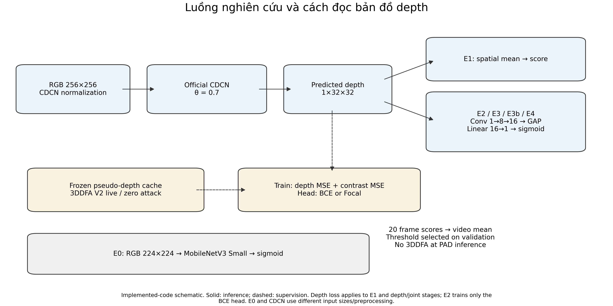

Chỉ dùng nhãn 3DDFA V2 khi huấn luyện; khi chạy thực tế mô hình chỉ nhận ảnh RGB.
> Độ sâu giả lập (pseudo-depth) được tạo sẵn từ mô hình 3D 3DDFA V2, không cần cảm biến đo chiều sâu.

<!--
Thưa thầy, đây là quy trình hoạt động của hệ thống. Ở bước chuẩn bị dữ liệu
trước khi huấn luyện, nhóm dùng mô hình 3DDFA V2 để sinh nhãn độ sâu 3D cho ảnh
người thật, còn ảnh giả mạo thì gán bản đồ phẳng bằng 0. Trong quá trình huấn
luyện, mạng CDCN học cách dự đoán bản đồ độ sâu từ ảnh RGB. Khi đưa vào kiểm
tra thực tế (suy luận), hệ thống chỉ cần ảnh RGB đầu vào, dự đoán độ sâu cho 20
khung hình rồi tính điểm trung bình cho cả video mà không cần chạy lại 3DDFA V2.
-->

---

<!-- _class: figure -->

## Dữ liệu CASIA: Chia tách biệt theo từng người

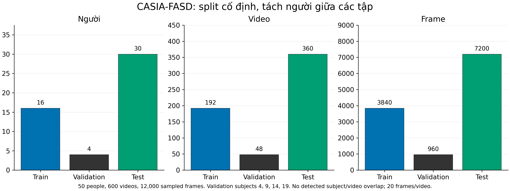

Tổng 600 video của 50 người · Lấy 20 khung hình/video · Tổng cộng 12.000 khung hình.
> Chia tách biệt theo người (không trùng người giữa các tập). Tập kiểm tra có 360 video (270 giả mạo, 90 người thật).

<!--
Về dữ liệu, nhóm sử dụng bộ dữ liệu CASIA gồm 50 người với 600 video, mỗi video
trích xuất 20 khung hình, tổng cộng 12.000 khung hình. Để đánh giá khách quan,
nhóm chia tách biệt theo người: 16 người cho tập huấn luyện, 4 người cho tập
kiểm định để chọn mô hình và ngưỡng, và 30 người cho tập kiểm tra. Không có bất
kỳ người nào xuất hiện trùng giữa ba tập, và cách chia này được giữ cố định
xuyên suốt từ E0 đến E4.
-->

---

## Kiểm tra chất lượng 12.000 nhãn độ sâu

| Phân loại khung hình | Số mẫu | Nhãn độ sâu khi huấn luyện | Kết quả rà soát dữ liệu |
|---|---:|---|---|
| Người thật | 3.000 | Bản đồ độ sâu 3D (3DDFA V2) | Đầy đủ, hợp lệ, không bị rỗng |
| Giả mạo | 9.000 | Bản đồ phẳng bằng 0 | Đầy đủ, đúng toàn bộ giá trị 0 |

**Mặt nạ vùng mặt:** Xác định vùng khuôn mặt thật để tính sai số độ sâu khi phân tích.

Việc gán nhãn 0 cho ảnh giả là **quy ước huấn luyện** để dạy mạng phân biệt thật/giả,
không có nghĩa là mô hình 3D không dựng được mặt từ ảnh in.

> Bước kiểm tra đảm bảo 100% file nhãn không bị lỗi kỹ thuật; bản thân nhãn từ 3DDFA V2 là độ sâu ước lượng xấp xỉ.

<!--
Trước khi chạy các thực nghiệm mới, nhóm đã rà soát lại toàn bộ 12.000 nhãn độ
sâu để đảm bảo không có lỗi dữ liệu. Cả 3.000 khung hình người thật và 9.000
khung hình giả mạo đều hợp lệ. Nhóm cũng xin làm rõ một điểm: việc gán bản đồ
bằng 0 cho ảnh giả là quy ước giám sát của phương pháp CDCN nhằm kéo đầu ra của
ảnh giả về 0, chứ không phải vì 3DDFA V2 không nhận ra mặt trên ảnh in.
-->

---

<!-- _class: figure -->

## E1: Tái lập mô hình CDCN gốc làm mốc so sánh

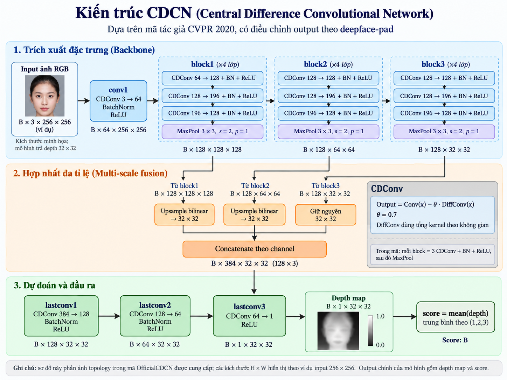

Trích xuất đặc trưng 3 tầng → Bản đồ độ sâu 32 × 32 → Lấy trung bình cộng các điểm ảnh.
> Sơ đồ minh họa kiến trúc CDCN. E1 giữ nguyên cấu trúc mạng và hàm mất mát của tác giả gốc trên tập dữ liệu của nhóm.

<!--
Ở thực nghiệm E1, nhóm tái lập đúng kiến trúc Official CDCN của tác giả gốc để
làm mốc đối chứng. Mạng trích xuất đặc trưng ở ba tầng thấp, trung và cao, sau
đó gộp lại để dự đoán bản đồ độ sâu kích thước 32x32. Điểm số thật/giả của mỗi
khung hình được tính đơn giản bằng cách lấy trung bình cộng toàn bộ các điểm
trên bản đồ 32x32 này.
-->

---

<!-- _class: figure -->

## E2: Giữ nguyên CDCN, thêm nhánh phân loại nhẹ

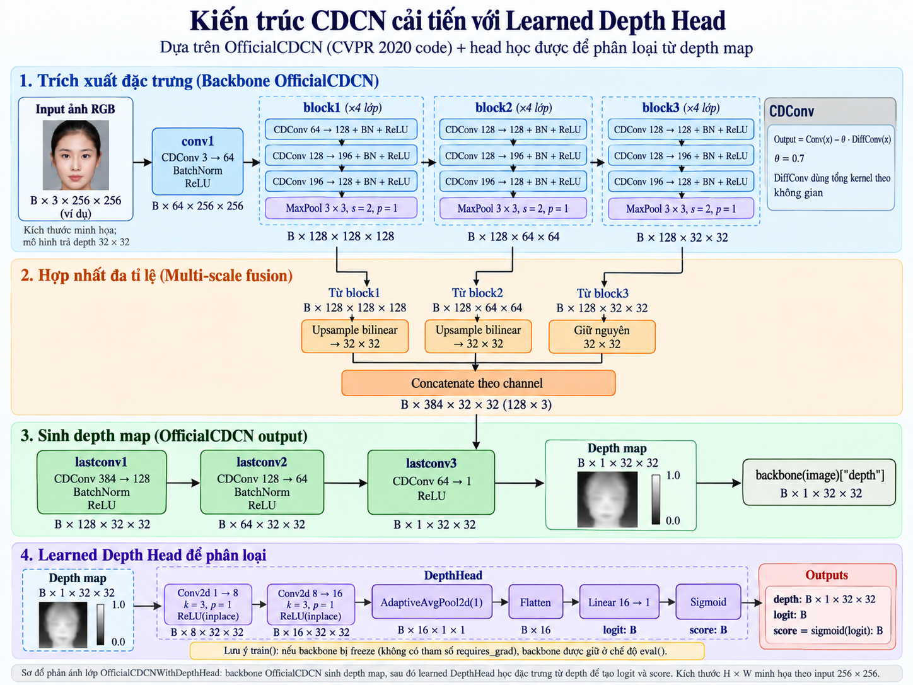

Đóng băng toàn bộ mạng CDCN (từ E1); chỉ huấn luyện thêm nhánh phân loại (1.265 tham số).
> Sơ đồ minh họa. E1 và E2 tạo ra cùng một bản đồ độ sâu, chỉ khác nhau ở bước chuyển bản đồ thành điểm số.

<!--
Sang thực nghiệm E2, nhóm giữ nguyên hoàn toàn trọng số của mạng CDCN tốt nhất
từ E1 (đóng băng cả mạng trích xuất lẫn các lớp chuẩn hóa), nên bản đồ độ sâu
32x32 tạo ra ở E2 giống hệt E1. Điểm khác duy nhất là thay vì lấy trung bình
cộng, nhóm đưa bản đồ 32x32 này qua một mạng tích chập nhỏ chỉ gồm 1.265 tham số
(tăng 0,056%) để mạng tự học cách chấm điểm thật/giả từ hình dạng của bản đồ.
-->

---

<!-- _class: figure -->

## E3–E4: Huấn luyện toàn mạng trong 16 epoch

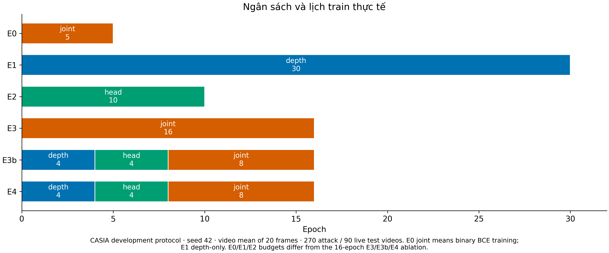

So sánh E3 ↔ E3b để xét cách chia giai đoạn; so sánh E3b ↔ E4 để xét hàm BCE và Focal.
> Cả 3 nhánh đều khởi tạo từ E1 (seed 42). Lịch chia giai đoạn: 4 epoch độ sâu + 4 epoch nhánh phân loại + 8 epoch toàn mạng.

<!--
Ở E3, E3b và E4, nhóm mở khóa cho phép cập nhật lại cả mạng CDCN lẫn nhánh phân
loại với cùng tổng thời lượng 16 epoch:
- E3 huấn luyện đồng thời toàn mạng ngay từ đầu với hàm mất mát BCE.
- E3b chia làm 3 giai đoạn (4 epoch chỉnh độ sâu, 4 epoch chỉnh bộ phân loại,
  8 epoch huấn luyện chung) cũng dùng BCE, nhằm so sánh trực tiếp với E3.
- E4 giữ nguyên lịch chia giai đoạn như E3b nhưng đổi BCE sang Focal Loss để
  tập trung hơn vào các mẫu khó phân loại.
-->

---

## Chọn mô hình E3 trên tập kiểm định trước test

| Mô hình thử nghiệm | Lỗi ACER (Kiểm định) | Sai số phân loại BCE | Epoch được chọn (giai đoạn chung) |
|---|---:|---:|---:|
| **E3 · Huấn luyện chung (BCE)** | **0,00%** | **0,010902** | **10** |
| E3b · Chia giai đoạn (BCE) | 0,00% | 0,014566 | 2 |
| E4 · Chia giai đoạn (Focal) | 0,00% | 0,087385 | 6 |

Trên tập kiểm định (48 video của 4 người), cả ba nhánh đều đạt AUC = 1,00.

**Nhóm chọn E3 (có sai số BCE thấp nhất) và khóa ngưỡng quyết định trước test.**

> Dùng sai số BCE trên tập kiểm định (validation) làm tiêu chí chung để chọn mô hình cho cả 3 nhánh, kể cả nhánh E4 huấn luyện bằng Focal.

<!--
Khi đánh giá trên tập kiểm định (validation) gồm 48 video của 4 người, cả ba
nhánh E3, E3b và E4 đều phân biệt đúng 100% (ACER = 0% và AUC = 1,00). Để chọn
ra một mô hình đại diện khách quan trước khi mở tập kiểm tra (test), nhóm dựa
trên tiêu chí phụ đã định trước là sai số phân loại BCE. Vì E3 có BCE thấp nhất
(0,0109), nhóm chốt chọn E3 và khóa cố định ngưỡng phân loại của từng mô hình
trước khi chấm trên tập kiểm tra.
-->

---

<!-- _class: figure -->

## Kết quả: E3 và E4 chưa giảm ACER so với E1/E2

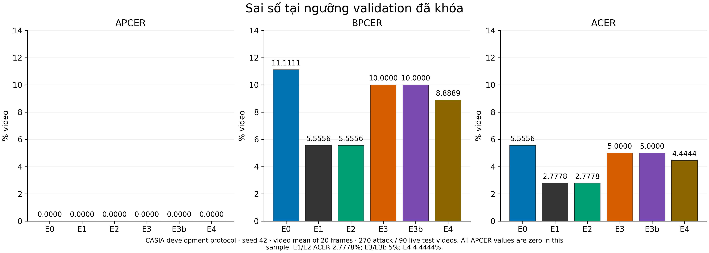

Tỷ lệ lỗi ACER: E1 và E2 thấp nhất (**2,78%**) · E3 và E3b (**5,00%**) · E4 (**4,44%**).
> Tập kiểm tra gồm 360 video (270 giả mạo + 90 người thật). Mọi mô hình đều chặn đúng 100% giả mạo (APCER = 0%), chỉ sai ở người thật (BPCER).

<!--
Thưa thầy, đây là kết quả trên 360 video của tập kiểm tra. Điểm đáng chú ý là
tất cả các mô hình đều chặn đúng toàn bộ 270 video giả mạo (APCER = 0%), nên
toàn bộ lỗi đều nằm ở việc từ chối nhầm video người thật (BPCER):
- Hai mô hình đầu tiên là E1 và E2 chỉ từ chối nhầm 5/90 video người thật, đạt
  ACER tốt nhất là 2,78%.
- Khi mở khóa huấn luyện lại toàn mạng, E3 và E3b từ chối nhầm 9/90 video
  (ACER = 5,00%), còn E4 dùng Focal Loss từ chối nhầm 8/90 video (ACER = 4,44%).
Như vậy, việc huấn luyện lại toàn mạng ở E3 và E4 chưa giảm được lỗi so với E1/E2.
-->

---

<!-- _class: dense -->

## Ba phép đối chiếu trả lời ba câu hỏi chính

| Cặp đối chiếu | Câu hỏi kiểm chứng | Kết quả kiểm tra (ACER) |
|---|---|---|
| **E1 → E2** | Thêm nhánh đọc độ sâu (giữ nguyên CDCN) có tốt hơn trung bình cộng? | **2,78% → 2,78%** (Không đổi, cùng sai 5 video) |
| **E3 → E3b** | Chia giai đoạn có tốt hơn huấn luyện chung toàn mạng? | **5,00% → 5,00%** (Bằng số lỗi, khác video bị sai) |
| **E3b → E4** | Đổi hàm mất mát từ BCE sang Focal có giúp giảm lỗi? | **5,00% → 4,44%** (Giảm được 1 video bị sai) |

**Nhận xét:** Hàm mất mát Focal (E4) cải thiện nhẹ so với BCE (E3b) ở lần chạy này,
nhưng vẫn có tỷ lệ lỗi cao hơn so với giữ nguyên mạng gốc (E1, E2).

> Lưu ý: E0 dùng mạng khác (MobileNetV3) và E2 có số epoch/tốc độ học khác E3, nên nhóm chỉ kết luận trực tiếp trên 3 cặp đối chiếu có kiểm soát ở trên.

<!--
Tổng kết lại ba phép so sánh có kiểm soát chặt:
1. Từ E1 sang E2: Khi giữ nguyên bản đồ độ sâu của CDCN, việc thay phép lấy
   trung bình cộng bằng bộ phân loại nhỏ cho kết quả giống hệt nhau (cùng sai
   đúng 5 video đó).
2. Từ E3 sang E3b: Huấn luyện chia giai đoạn và huấn luyện chung có cùng mức
   ACER 5,00%, chỉ đổi vị trí một video sai.
3. Từ E3b sang E4: Hàm Focal giúp cứu được 1 video người thật (ACER giảm từ
   5,00% xuống 4,44%), nhưng nhìn chung vẫn chưa tốt bằng mốc 2,78% của E1/E2.
-->

---

<!-- _class: figure -->

## So sánh từng video: Sửa lỗi cũ nhưng thêm lỗi mới

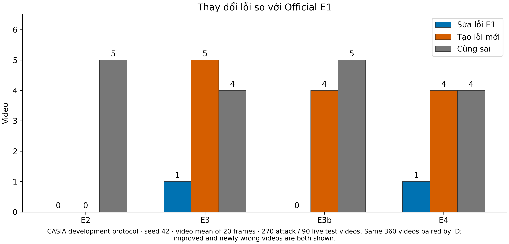

So với mốc E1: E3 sửa được 1 lỗi nhưng phát sinh 5 lỗi mới; E4 sửa được 1 lỗi nhưng phát sinh 4 lỗi mới.
> Đối chiếu trực tiếp trên cùng 360 video. “Sửa lỗi” và “lỗi mới” tính theo ngưỡng quyết định đã khóa riêng của từng mô hình.

<!--
Để hiểu vì sao ACER của E3 và E4 tăng lên, nhóm đã đối chiếu kết quả dự đoán
trên từng video cụ thể so với E1. Kết quả cho thấy E3 và E4 thực ra có sửa được
1 video mà E1 bị sai (video s39_v1), nhưng đổi lại việc cập nhật lại toàn mạng
lại làm phát sinh thêm 4 đến 5 video người thật khác bị từ chối nhầm. Giữa E3
và E3b tuy cùng ACER 5,00% nhưng cũng có sự hoán đổi 1 video đúng/sai.
-->

---

<!-- _class: figure -->

## Lỗi phát sinh tập trung ở video chất lượng thấp

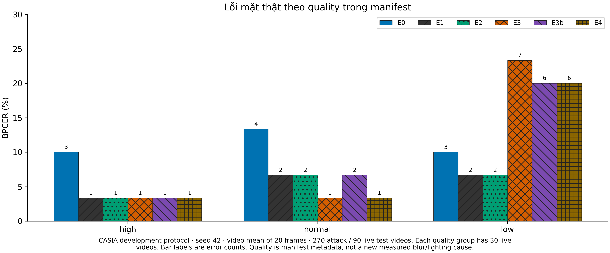

Số video người thật bị từ chối nhầm ở nhóm chất lượng thấp: E1/E2 = 2 · E3 = 7 · E3b/E4 = 6.
> 90 video người thật gồm 3 mức chất lượng (Thấp, Bình thường, Cao — mỗi mức 30 video) theo nhãn của bộ dữ liệu CASIA.

<!--
Khi phân tích kỹ hơn xem các lỗi mới nằm ở đâu, nhóm chia 90 video người thật
theo 3 mức chất lượng hình ảnh của bộ dữ liệu CASIA (Thấp, Bình thường, Cao).
Thầy có thể thấy ở nhóm chất lượng cao và bình thường, các mô hình sai rất ít
(chỉ 1–2 video). Tuy nhiên ở nhóm chất lượng thấp, trong khi E1 và E2 chỉ sai
2/30 video thì E3, E3b và E4 lại sai tới 6–7/30 video. Đây là gợi ý quan trọng
để nhóm phân tích hình ảnh ở bước tiếp theo.
-->

---

<!-- _class: figure -->

## Minh họa: Video người thật bị E3 từ chối nhầm

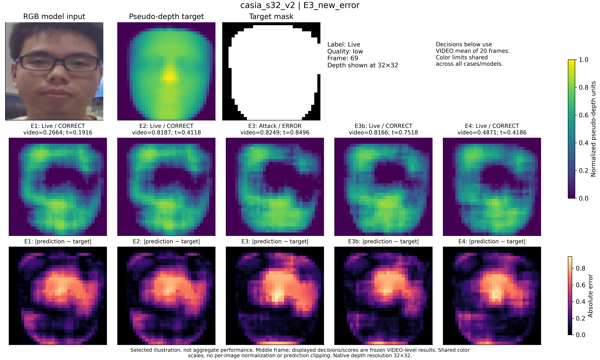

> Một frame giữa video người thật casia_s32_v2. E1, E2, E3b, E4 đều nhận đúng; riêng E3 có điểm video (0,825) hụt nhẹ dưới ngưỡng (0,850).

<!--
Thưa thầy, đây là hình ảnh trích xuất thực tế từ video người thật casia_s32_v2
— trường hợp mà E1, E2, E3b và E4 đều nhận diện đúng, nhưng riêng E3 bị từ chối
nhầm. Hàng trên là ảnh RGB gốc, nhãn độ sâu 3DDFA V2 và vùng mặt nạ; hai hàng
dưới là bản đồ độ sâu dự đoán và bản đồ sai số của từng mô hình. Ở trường hợp
này, điểm trung bình 20 khung hình của E3 vẫn đạt 0,825 (khá cao), nhưng do
ngưỡng chọn từ tập kiểm định của E3 bị đẩy lên quá cao (0,850) nên video này
bị đánh trượt.
-->

---

## Sai số độ sâu (MAE) và khả năng phân loại

| Mô hình | Ảnh giả · Toàn ảnh | Người thật · Toàn ảnh | Người thật · Vùng mặt |
|---|---:|---:|---:|
| E3 · Huấn luyện chung (BCE) | 0,01794 | **0,09843** | **0,11706** |
| E3b · Chia giai đoạn (BCE) | 0,01665 | 0,10442 | 0,12409 |
| E4 · Chia giai đoạn (Focal) | **0,00781** | 0,13076 | 0,15585 |

**MAE** là độ lệch trung bình giữa độ sâu dự đoán và nhãn độ sâu gốc (càng nhỏ càng sát nhãn).

**Sai số bản đồ độ sâu (MAE) và tỷ lệ lỗi phân loại (ACER) phản ánh hai khía cạnh khác nhau.**

> Đo trên tập kiểm định (720 khung hình giả + 240 khung hình thật). Đơn vị theo nhãn độ sâu chuẩn hóa [0, 1], không phải cm.

<!--
Nhóm cũng kiểm tra xem chất lượng tái tạo bản đồ độ sâu (đo bằng sai số tuyệt
đối trung bình MAE) có tỷ lệ thuận với độ chính xác phân loại hay không. Bảng
số liệu cho thấy E4 ép bản đồ của ảnh giả về 0 sát nhất (MAE = 0,00781), nhưng
trên ảnh người thật thì E3 lại bám sát nhãn độ sâu 3DDFA V2 hơn (MAE = 0,09843).
Điều này cho thấy việc dự đoán bản đồ độ sâu gần nhãn hơn hay xa nhãn hơn không
quyết định trực tiếp việc ngưỡng phân loại video có bị lệch hay không.
-->

---

## Kết luận hiện tại và phạm vi của thực nghiệm

- **Đã hoàn tất chuỗi thực nghiệm E0–E4:** Kiểm chứng đầy đủ việc thêm nhánh phân loại độ sâu, chia giai đoạn huấn luyện và đổi hàm mất mát Focal.
- **Mốc E1 và E2 đang cho kết quả tốt nhất (ACER = 2,78%):** Việc huấn luyện lại toàn mạng ở E3, E3b, E4 làm phát sinh thêm lỗi ở nhóm video chất lượng thấp.
- **Giữ đúng quy trình đánh giá:** Tiếp tục dùng **E3** (được chọn từ tập kiểm định) để kiểm tra lặp lại, không nhìn kết quả kiểm tra để chọn lại mô hình.
- **Phạm vi kết quả:** Mới chạy trên **một seed** (seed 42) và một bộ dữ liệu; tập **test phát triển** đã xem qua nhiều lượt.

> Kết quả hiện tại phản ánh đúng quy trình phát triển trên tập CASIA của nhóm; chưa mở rộng sang tập dữ liệu khác hoặc chạy thử nghiệm webcam.

<!--
Tóm lại, qua 5 lượt thực nghiệm từ E0 đến E4, nhóm rút ra kết luận chính là trên
tập dữ liệu CASIA với seed 42, mô hình CDCN gốc (E1) và nhánh phân loại đóng
băng mạng gốc (E2) đang đạt hiệu quả cao nhất với ACER 2,78%. Khi mở khóa toàn
mạng ở E3–E4, do tập kiểm định khá nhỏ (48 video) nên ngưỡng phân loại bị đặt
quá khắt khe, dẫn đến từ chối nhầm thêm một số video người thật chất lượng thấp.
Nhóm giữ nguyên kết quả này và chọn E3 đúng theo quy tắc ban đầu để kiểm tra độ
ổn định ở bước tiếp theo.
-->

---

## Kế hoạch tiếp theo: Kiểm tra độ ổn định

1. **Bước 6 · Chạy lặp lại với nhiều seed (E1 và E3):** Chạy thêm trên các seed 43, 44, 45 trong cùng môi trường để tính trung bình và độ lệch chuẩn của ACER.
2. **Bước 7 · Phân tích sâu các ca lỗi và thử nghiệm webcam:** Trực quan hóa thêm các video bị sai chung hoặc sai mới giữa các mô hình; thử nghiệm thực tế qua webcam.
3. **Bước 8 · Đo tốc độ xử lý và hoàn thiện báo cáo:** Đo thời gian chạy trên cùng thiết bị, đối chiếu quy trình với bài báo gốc và hoàn thiện quyển báo cáo.

> Đây là các bước công việc tiếp theo trong kế hoạch; hiện nhóm chưa đưa các con số ước lượng hoặc kết quả webcam chưa kiểm chứng vào slide.

<!--
Về kế hoạch sắp tới, nhóm còn 3 bước:
- Bước 6: Chạy lặp lại cặp mô hình E1 và E3 trên 3 seed mới (43, 44, 45) để xem
  chênh lệch giữa E1 và E3 có ổn định hay chỉ xảy ra ngẫu nhiên ở seed 42.
- Bước 7: Xuất thêm hình ảnh phân tích các ca lỗi ở nhóm chất lượng thấp và
  triển khai bản chạy thử qua webcam.
- Bước 8: Đo đạc tốc độ xử lý trên cùng một cấu hình phần cứng và tổng hợp toàn
  bộ thành báo cáo hoàn chỉnh.
-->

---

<!-- _class: closing -->
<!-- _backgroundImage: url("assets/dut-closing.png") -->
<!-- _paginate: false -->

# Trân trọng cảm ơn

**Nhóm chúng em rất mong nhận được ý kiến góp ý của thầy.**

Nội dung nhóm mong muốn xin ý kiến:  
Độ ổn định qua các seed và cách hạn chế lỗi từ chối nhầm ở video chất lượng thấp.

<!--
Phần trình bày chính của nhóm đến đây là hết. Nhóm chúng em cảm ơn thầy đã lắng
nghe và rất mong nhận được sự góp ý của thầy. Bốn trang phụ lục phía sau là bảng
số liệu chi tiết để phục vụ phần trao đổi ạ.
-->

---

<!-- _class: figure -->

## Phụ lục · Tổng hợp các chỉ số từ E0 đến E4

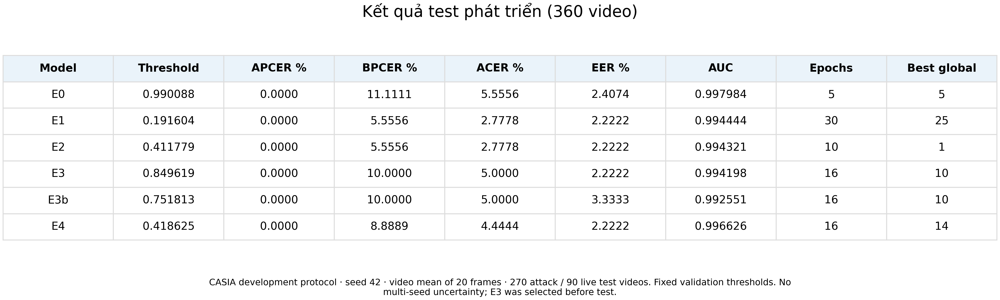

> APCER, BPCER, ACER, EER tính theo % (càng thấp càng tốt); AUC trong đoạn [0, 1]. Đánh giá trên 360 video với ngưỡng validation cố định, seed 42.

<!--
Đây là bảng đầy đủ tất cả các chỉ số trên tập Test từ E0 (MobileNetV3 RGB) đến
E4. Có thể thấy E0 đạt AUC rất cao (0,9980) nhưng khi áp ngưỡng cố định từ
Validation thì ACER lại là 5,56%, cao hơn mức 2,78% của E1 và E2.
-->

---

<!-- _class: figure -->

## Phụ lục · Vì sao AUC cao hơn nhưng ACER lại tăng?

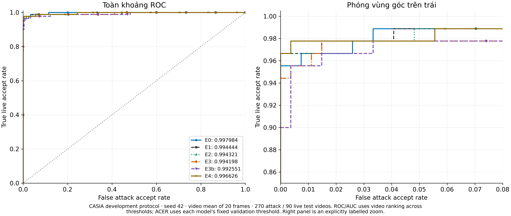

Mô hình E4 có AUC cao hơn E1 (0,9966 > 0,9944), nhưng tỷ lệ lỗi ACER của E4 (4,44%) lại cao hơn E1 (2,78%).
> AUC đánh giá khả năng xếp hạng điểm số qua mọi ngưỡng; còn ACER phụ thuộc vào một ngưỡng cố định được chọn từ tập kiểm định.

<!--
Trang phụ lục này giải thích vì sao AUC của E3/E4 cao hơn E1 nhưng ACER lại kém
hơn. Đường cong ROC và chỉ số AUC đánh giá thứ tự điểm số trên toàn bộ dải
ngưỡng. Trong khi đó, ACER chỉ xét tại đúng 1 ngưỡng duy nhất lấy từ tập
kiểm định. Ở E3 và E4, ngưỡng chọn từ tập kiểm định bị lệch nhẹ so với phân
phối điểm của tập kiểm tra nên làm tăng số video người thật bị từ chối nhầm.
-->

---

<!-- _class: figure -->

## Phụ lục · Các video người thật bị từ chối nhầm

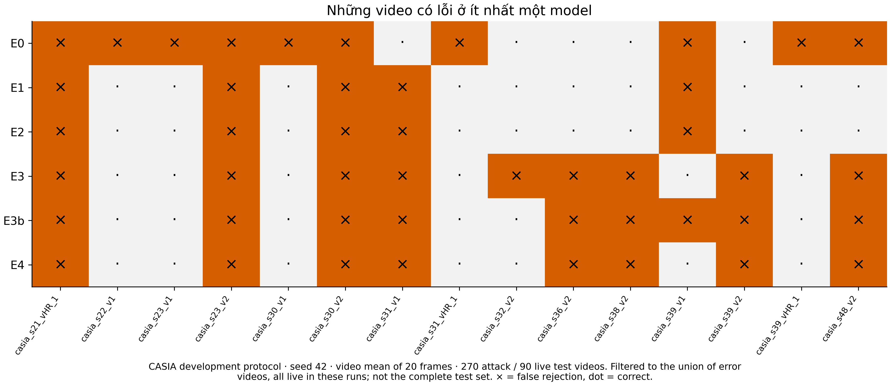

> Ma trận liệt kê các video bị ít nhất một mô hình dự đoán sai (với ngưỡng cố định từ tập kiểm định). Các video còn lại trong 360 video đều đúng.

<!--
Ma trận này liệt kê cụ thể mã số của từng video bị sai qua 6 mô hình:
- Có 4 video người thật bị tất cả các mô hình nhánh độ sâu (E1–E4) cùng từ chối
  nhầm: s21_vHR_1, s23_v2, s30_v2 và s31_v1.
- Có 4 video người thật mà E1/E2 nhận đúng nhưng cả 3 nhánh mở khóa (E3, E3b,
  E4) đều làm sai thêm: s36_v2, s38_v2, s39_v2 và s48_v2.
-->

---

<!-- _class: sources -->

## Phụ lục · Nguồn dữ liệu và tài liệu tham khảo

- **Báo cáo kết quả chi tiết:** `ROUND_5_TEST_RESULTS_2026-10-16` và
  `ROUND_5_FULL_VALIDATION_2026-10-16`.
- **Lưu trữ mô hình & nhật ký chạy:** Google Drive `face-pad/runs/` và
  `face-pad/reports/round5-525c80889106/`.
- **Nguồn hình ảnh minh họa:** Biểu đồ xuất trực tiếp từ file kết quả E0–E4;
  ảnh trích xuất thực tế từ video `casia_s32_v2`; sơ đồ kiến trúc mạng.
- **Bài báo gốc CDCN:** Zitong Yu và cộng sự, CVPR 2020,
  [Searching Central Difference Convolutional Networks](https://arxiv.org/abs/2003.04092).

> File Markdown là bản gốc; xuất ra PDF/PPTX để trình chiếu. Khung giao diện theo mẫu Template-DUT-Total.pptx.

<!--
Toàn bộ mã nguồn, kết quả chạy (checkpoint, file điểm số CSV) của lượt 5 đều
được lưu trữ tại commit 525c80889106c06525f5b758e8725c8ac9cee856 và có thể đối
chiếu lại đầy đủ.
-->
